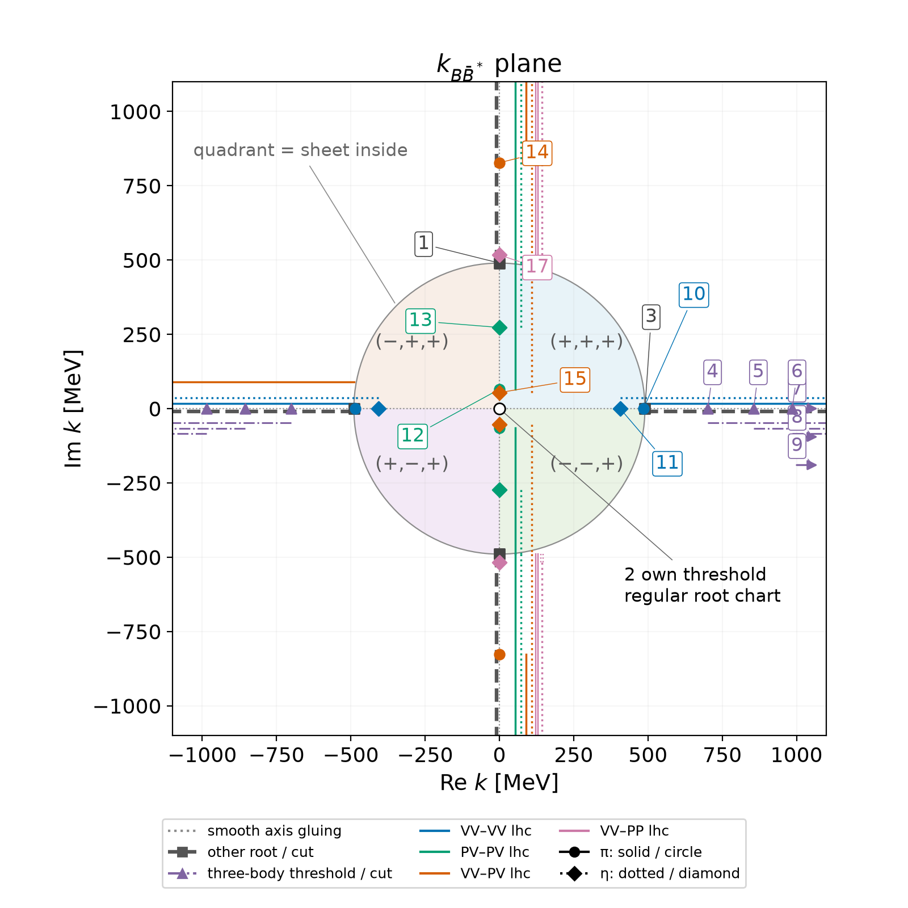
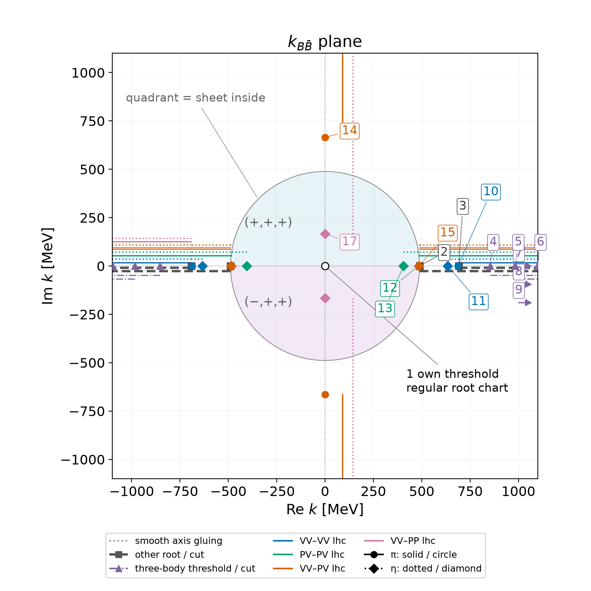
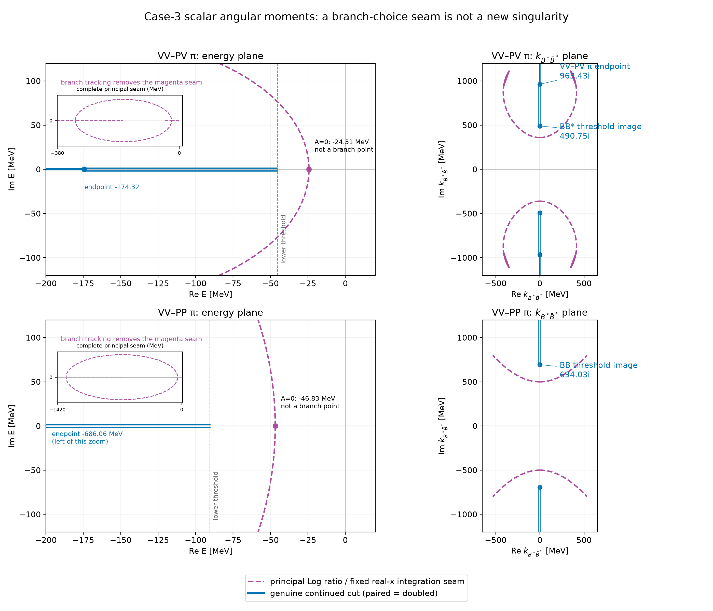

# 05 — Singularity map of the $2^{++}$ LSE: what the continuation will meet

Notation: CONVENTIONS.md ("Energy origin and on-shell momentum", "Lippmann–Schwinger equation", "Pole position and Riemann sheets", "Continuation to other sheets", "Continued angular moments", "Reduced masses and TOPT energy offsets", "Projected OME potential"). Energies $E$ are measured from $2m_{B^*}=10649.50$ MeV; masses as in GLOSSARY.md, "Isospin limit". No pole position is assumed anywhere in this note: $X_{b2}$ is not yet determined (NOTEBOOK.md, Decisions, "Singularity map"). Energies used to draw a plane are *probe energies* at the midpoints of the regions between thresholds ($-67.85$, $-22.62$, $+23.79$ MeV), never predictions.

Abbreviations: OME, one-meson ($\pi$ and $\eta$) exchange; TOPT, time-ordered perturbation theory; $P=B$, $V=B^*$, so $VV$, $PV$, $PP$ are the $B^*\bar B^*$, $C$-even $B\bar B^*$ and $B\bar B$ channels; lhc/rhc, left-/right-hand cut.

Code: `notes/05-singularity-map/` (`kinematics.py` shared; one script per figure; run each with `uv run --script`).

**Reading route for doing the calculation yourself.** Section 2.1 derives the threshold singularities directly from the denominators; Sec. 3.1 constructs the momentum charts. In Sec. 4, first do the angular integral with independent $p,p',E$, then impose the on-shell relations: these are different operations, and only the latter produces the familiar near-threshold left-hand endpoints. Sections 4.2–4.4 distinguish an endpoint, the discontinuity of a continued function, and a seam of its principal-log representation. Section 5 derives the moving loop-momentum endpoints; Sec. 6.1 explains the conditional connection to the pole determinant. Section 8.1 states what is held fixed when a parameter changes.

**Status and assumptions.** Everything below uses the isospin-limit masses, nonrelativistic heavy-meson energies, relativistic exchanged-meson energy, sharp finite cutoff, and channel basis already agreed in the binding references. “Exact TOPT” here means exact within those specified heavy-meson kinetic energies, not relativistically exact. The added algebra makes the map reproducible; it does not select a contour policy, settle the branch-tracker discrepancy, or promote the map to Established. The user still selects independent physics checks in Sec. 9.

## 1. Why $2^{++}$ needs the continuation

All $1^{++}$ states of the baseline fit ([@Zhang:2026iyr] v1, Table V) and of the shallow-$X_b$ fit (NOTEBOOK.md, Established) lie below the lowest $1^{++}$ two-body threshold, $B\bar B^*$; $B\bar B$ cannot form $1^{++}$. They are bound states on the physical sheet, zeros of $\det(\hat v^{-1}+\hat J)$ at real $E$ ([@Zhang:2026iyr] v1, Eq. (93)), found with the loop momentum on the real axis.

In $2^{++}$ the $D$-wave channels $B\bar B(^1D_2)$ and $B\bar B^*(^3D_2)$ open $90.46$ and $45.23$ MeV below $2m_{B^*}$. A state near the $B^*\bar B^*$ threshold can decay into them, so its pole leaves the physical sheet and the real-axis loop no longer reaches it. A state below $2m_B=10559.04$ MeV is still a bound state on the physical sheet.

Four kinds of singularity shape the amplitude near the $B^*\bar B^*$ threshold:

1. **Two-body thresholds** (square-root branch points, right-hand cuts): three distinct ones, hence eight two-body sheets.
2. **Three-body thresholds** of the TOPT intermediate states $B^{(*)}\bar B^{(*)}\phi$: the lowest, $B\bar B\pi$, lies only $47.58$ MeV above $2m_{B^*}$.
3. **Left-hand cuts** of the on-shell OME, one family per transition and exchanged meson.
4. **Singularities of the LSE integrand** in the complex loop momentum $q$, which decide where the loop contour may go.

**Two different objects carry singularities.** Sections 3 and 4 map the *on-shell exchange potential*, the amplitude with its external momenta on shell: what residues and couplings see. Pole positions come from the integral equation, whose momenta run along the loop contour; its singularities (Secs. 5 and 6) are different. A left-hand cut of the on-shell potential is therefore not automatically a barrier for the pole search.

## 2. Energy landscape

| threshold | $M$ (MeV) | $E$ (MeV) | role in the model |
|---|---|---|---|
| $B\bar B$ | 10559.04 | $-90.46$ | channel 6, $^1D_2$ |
| $B\bar B^*$ | 10604.27 | $-45.23$ | channel 5, $^3D_2$ |
| $B^*\bar B^*$ | 10649.50 | $0$ | channels 1–4, $^5S_2,{}^1D_2,{}^5D_2,{}^5G_2$ |
| $B\bar B\pi$ | 10697.08 | $+47.58$ | TOPT intermediate state $\beta=1$ |
| $B\bar B^*\pi$ | 10742.31 | $+92.81$ | $\beta=3,4$ |
| $B^*\bar B^*\pi$ | 10787.54 | $+138.04$ | $\beta=2$ |
| $B\bar B\eta$, $B\bar B^*\eta$, $B^*\bar B^*\eta$ | | $+457.54$, $+502.77$, $+548.00$ | $\beta=1$; $3,4$; $2$ |
| $B_s\bar B_s$, $B_s\bar B_s^*$, $B_s^*\bar B_s^*$ | 10733.84, 10782.32, 10830.80 | $+84.34$, $+132.82$, $+181.30$ | not in the model |

The two-body sheets are labelled by the signs of $\operatorname{Im}k$ at $(B\bar B,B\bar B^*,B^*\bar B^*)$. The sheet reached from the physical real axis between two consecutive thresholds is the *adjacent* sheet of that region: $(-,+,+)$ between $B\bar B$ and $B\bar B^*$, $(-,-,+)$ between $B\bar B^*$ and $B^*\bar B^*$, $(-,-,-)$ above $B^*\bar B^*$. Above $+47.58$ MeV the three-body cut opens as well, and the two-body labels no longer exhaust the sheet structure.

The $B^*$ is stable ($\Delta m=45.23$ MeV $<m_\pi$), so no three-body state is on shell below $+47.58$ MeV, unlike the charm case, where $D^*\to D\pi$ is open.

![Three views of one continuation. Left: the energy $E$ selects the kinematics; moving down from the real axis between $B\bar B^*$ and $B^*\bar B^*$ lands on $(-,-,+)$. Middle: the signs of the momenta identify the sheet; in the $k_{B^*\bar B^*}$ plane that sheet is the quadrant Q2. Right: the loop contour $\mathcal C$ implements the choice, passing below the flipped poles $k_5$, $k_6$ and above the unflipped $-k_1$. A point in the middle panel is an external on-shell momentum; a point on $\mathcal C$ is an integration momentum. The probe energy $-22.62-10i$ MeV is not a predicted pole.](05-singularity-map/figures/overview.png){width=100%}

### 2.1 Deriving the thresholds rather than reading them from a plot

For a channel with heavy masses $m_a,m_b$,

$$
\omega_a(q)+\omega_b(q)-M
=m_a+m_b-2m_{B^*}-E
+\frac{q^2}{2}\left(\frac1{m_a}+\frac1{m_b}\right)
=\delta_\alpha-E+\frac{q^2}{2\mu_\alpha},
\qquad \mu_\alpha=\frac{m_am_b}{m_a+m_b}.
$$

Thus

$$
G_\alpha(q;E)=\frac{2\mu_\alpha}{q^2-k_\alpha^2-i0},
\qquad k_\alpha^2=2\mu_\alpha(E-\delta_\alpha).
$$

At $E=\delta_\alpha$ the poles $q=\pm k_\alpha$ meet the fixed lower endpoint $q=0$. Continuing around this energy changes the sign of $k_\alpha$: this is the two-body square-root branch point. The four $VV$ partial waves share the same square root, so there are three independent two-body signs, not six: $2^3=8$ two-body sheets.

To see the nonanalytic term explicitly, strip off the other, smooth factors in one loop and integrate the propagator with its radial measure:

$$
\begin{aligned}
J_\alpha(E)
&=\int_0^\Lambda\frac{q^2\,dq}{2\pi^2}G_\alpha(q;E)
=\frac{\mu_\alpha}{\pi^2}
\int_0^\Lambda dq\,\left(1+\frac{k_\alpha^2}{q^2-k_\alpha^2-i0}\right),\\
J_\alpha(E+i0)
&=\frac{\mu_\alpha}{\pi^2}
\left[\Lambda+\frac{k_\alpha}{2}
\log\frac{\Lambda-k_\alpha}{\Lambda+k_\alpha}\right]
+i\frac{\mu_\alpha k_\alpha}{2\pi},
\qquad 0<k_\alpha<\Lambda.
\end{aligned}
$$

The logarithm in this last real-axis formula is real. Its extension off that axis requires continuation, not resetting a ratio log. The imaginary part has the positive sign of the canonical $G$, hence the canonical $\operatorname{Im}T^{-1}=+\rho$. Close to threshold,

$$
J_\alpha(E)=\frac{\mu_\alpha\Lambda}{\pi^2}
+i\frac{\mu_\alpha k_\alpha}{2\pi}
-\frac{\mu_\alpha k_\alpha^2}{\pi^2\Lambda}
+O(k_\alpha^4/\Lambda^3).
$$

The term linear in $k_\alpha\propto\sqrt{E-\delta_\alpha}$ is the branch. A partial-wave numerator can multiply it by additional threshold powers, but does not move the threshold. At $k_\alpha=\pm\Lambda$ the logarithm develops a second endpoint singularity: the artificial cutoff threshold

$$
E_{\Lambda,\alpha}=\delta_\alpha+\frac{\Lambda^2}{2\mu_\alpha}.
$$

For a TOPT ordering, the second denominator instead vanishes when the intermediate three-body energy equals the total energy:

$$
s(x)+\nu_\beta
=\omega_a(p')+\omega_b(p)
+\sqrt{m_\phi^2+p^2+p'^2-2pp'x}-(2m_{B^*}+E)=0.
$$

For real $p,p'$ and $x\in[-1,1]$, each kinetic contribution is nonnegative and the exchanged-meson energy is at least $m_\phi$. The minimum is attained at $p=p'=0$:

$$
E_{3,\beta}=m_a+m_b+m_\phi-2m_{B^*}
=
\begin{cases}
m_\phi-2\Delta m,&\beta=1,\\
m_\phi,&\beta=2,\\
m_\phi-\Delta m,&\beta=3,4.
\end{cases}
$$

This derives the three-body entries of the table. A zero at complex momenta below these energies is not a new real three-body threshold; it is part of the complex endpoint geometry derived in Sec. 5. The local threshold power of a fully projected three-body contribution requires its numerator and integrations and is not inferred from this minimum alone.

## 3. The channel momentum planes

Each distinct threshold has its own on-shell momentum, $k_\alpha^2=2\mu_\alpha(E-\delta_\alpha)$: $k_1$ (shared by channels 1–4), $k_5$ and $k_6$. Because every $k_\alpha^2$ is linear in $E$, the momenta are tied exactly by

$$
k_\beta^2=k_{\beta0}^2+\frac{\mu_\beta}{\mu_\alpha}k_\alpha^2,\qquad k_{\beta0}^2=2\mu_\beta(\delta_\alpha-\delta_\beta).
$$

We call the $k_\alpha$ plane a *chart*: using $k_\alpha$ instead of $E$ opens the square root of that channel's threshold into a plane, so the threshold itself, $k_\alpha=0$, is an ordinary point. The other momenta are two-valued there. Continue them from $k_\alpha=0$, where $k_{\beta0}$ is real and positive for a lower threshold and $+i|k_{\beta0}|$ for a higher one:

$$
k_\beta(k_\alpha)=k_{\beta0}\sqrt{1+\frac{\mu_\beta}{\mu_\alpha}\frac{k_\alpha^2}{k_{\beta0}^2}}\quad(\text{principal root}).
$$

Near the origin $\operatorname{Im}k_\beta\propto\operatorname{Re}k_\alpha\operatorname{Im}k_\alpha$ for every lower channel, so the four quadrants of the chart are four different sheets:

| chart | Q1 ($\operatorname{Re}>0,\operatorname{Im}>0$) | Q2 | Q3 | Q4 |
|---|---|---|---|---|
| $k_1$ ($B^*\bar B^*$) | $(+,+,+)$ | $(-,-,+)$ | $(+,+,-)$ | $(-,-,-)$ |
| $k_5$ ($B\bar B^*$) | $(+,+,+)$ | $(-,+,+)$ | $(+,-,+)$ | $(-,-,+)$ |
| $k_6$ ($B\bar B$) | $(+,+,+)$ | $(+,+,+)$ | $(-,+,+)$ | $(-,+,+)$ |

Real $E$ maps onto the two axes. In the $k_1$ chart the positive real axis is the physical region above $2m_{B^*}$, joined smoothly to $(-,-,-)$ below it; the positive imaginary axis is real $E<0$, seen from $(+,+,+)$ on its right and from the adjacent sheet $(-,-,+)$ on its left. The sheets on which an $X_{b2}$ pole would be reported, $(-,-,+)$ below and $(-,-,-)$ above $2m_{B^*}$, are the quadrants Q2 and Q4 of one picture. Two quadrants are *glued smoothly* along an axis segment when crossing it meets no singularity.

The gluing is smooth only up to the image of the next threshold. The continued $k_\beta$ has its cut on the axis beyond $k_\alpha=\pm\sqrt{-(\mu_\alpha/\mu_\beta)k_{\beta0}^2}$; crossing the axis there changes the sheet of channel $\beta$ as well. The images (MeV):

| chart | $B\bar B$ | $B\bar B^*$ | $B^*\bar B^*$ | $B\bar B\pi$ | $B\bar B^*\pi$ | $B^*\bar B^*\pi$ |
|---|---|---|---|---|---|---|
| $k_1$ | $\pm694.03\,i$ | $\pm490.75\,i$ | $0$ | $\pm503.34$ | $\pm702.98$ | $\pm857.34$ |
| $k_5$ | $\pm489.71\,i$ | $0$ | $\pm489.71$ | $\pm701.48$ | $\pm855.51$ | $\pm985.75$ |
| $k_6$ | $0$ | $\pm488.66$ | $\pm691.08$ | $\pm853.69$ | $\pm983.65$ | $\pm1098.35$ |

The quadrant picture of the $k_1$ chart is therefore exact inside the disc $|k_1|<490.75$ MeV, which covers $-45.23<E<+45.23$ MeV on the real axis; the $B\bar B\pi$ three-body cut starts just outside it, at $k_1=\pm503.34$ MeV.

The figures in this section and the next show singularities of the *on-shell exchange potential*. Section 6 explains which of them the pole condition sees.

![Near-origin $k_{B^*\bar B^*}$ chart of the on-shell exchange. The $B^*\bar B^*$ threshold is still at $k_1=0$, but the chart removes its square-root branching. Sheet signs are ordered $(B\bar B,B\bar B^*,B^*\bar B^*)$. Circles mark pion endpoints and diamonds eta endpoints; the cut lanes are drawn slightly beside their true position on the imaginary axis; dotted axis segments are smooth joins. Within $|k_1|<300$ MeV the only singularities are the $VV\leftarrow VV$ cuts from $\pm69.0\,i$ ($\pi$) and $\pm274.0\,i$ ($\eta$) MeV.](05-singularity-map/figures/k-plane-BsBs-zoom.png){width=75%}

{width=95%}

{width=95%}

{width=95%}

### 3.1 Constructing a chart and identifying its local sheets

Eliminate $E$ between two channel dispersion relations:

$$
\delta_\alpha+\frac{k_\alpha^2}{2\mu_\alpha}
=\delta_\beta+\frac{k_\beta^2}{2\mu_\beta}
\quad\Longrightarrow\quad
k_\beta^2=2\mu_\beta(\delta_\alpha-\delta_\beta)
+\frac{\mu_\beta}{\mu_\alpha}k_\alpha^2.
$$

For $\delta_\beta<\delta_\alpha$, let
$k_{\beta0}=\sqrt{2\mu_\beta(\delta_\alpha-\delta_\beta)}>0$.
Expanding the branch fixed at the origin gives

$$
k_\beta=k_{\beta0}
+\frac{\mu_\beta}{2\mu_\alpha k_{\beta0}}k_\alpha^2
+O(k_\alpha^4),\qquad
\operatorname{Im}k_\beta
=\frac{\mu_\beta}{\mu_\alpha k_{\beta0}}
\operatorname{Re}k_\alpha\,\operatorname{Im}k_\alpha
+O(|k_\alpha|^4).
$$

Hence a lower channel has positive sign in Q1 and Q3 and negative sign in Q2 and Q4. The chart channel itself has positive sign in Q1 and Q2 and negative sign in Q3 and Q4. A higher channel starts at $k_{\beta0}=+i|k_{\beta0}|$ and retains positive imaginary part sufficiently close to the origin. These three facts generate the quadrant table; they are not extra sheet assignments.

The expansion ceases to cover a single branch at the zeros of $k_\beta^2$:

$$
k_{\alpha,\beta{\rm th}}
=\pm\sqrt{2\mu_\alpha(\delta_\beta-\delta_\alpha)}.
$$

The image is imaginary for a lower threshold and real for a higher one. The same substitution maps a three-body threshold or a left-hand endpoint:

$$
k_{\alpha,s}=\pm\sqrt{2\mu_\alpha(E_s-\delta_\alpha)}.
$$

For example, $\mu_1=m_{B^*}/2$ gives
$k_{1,PV}=\pm i\sqrt{m_{B^*}\Delta m}$ and
$k_{1,BB\pi}=\pm\sqrt{m_{B^*}(m_\pi-2\Delta m)}$.
They are respectively the $490.75\,i$ and $503.34$ MeV entries. A change of coordinates does not move a physical energy singularity: it changes its image and can remove the square-root branching of the chart's own threshold. Nor does a choice of the three momentum signs determine all logarithmic windings; those must still be tracked.

## 4. Left-hand cuts of the on-shell OME

The TOPT potential of a transition is the sum of two time orderings $(\beta_1,\beta_2)$, labelled by the intermediate heavy pair: $\beta=1$ for $B\bar B\phi$, $2$ for $B^*\bar B^*\phi$, $3,4$ for $B\bar B^*\phi$, with $(\beta_1,\beta_2)=(2,2)$ for $VV\leftarrow VV$, $(1,2)$ for $PV\leftarrow PV$, $(2,3)$ and $(2,4)$ for $VV\leftrightarrow PV$, $(3,3)$ and $(4,4)$ for $VV\leftrightarrow PP$ (notes/04-ome-2pp.md, Sec. 2). Its partial-wave projection is $\sum_m\mathcal N^{(m)}_{\alpha'\alpha}\Delta_m^{(\beta_1\beta_2)}$, with the angular moments $\Delta_m=\int_{-1}^1x^m(D_{\beta_1}+D_{\beta_2})\,dx$ (CONVENTIONS.md, "Projected OME potential"). Two of the cases of [@Wu:2026wxb] v1, App. A, Eq. (A8) occur here: in Case 1 a single cut runs from the endpoint to the left; in Case 3 the cut is single below the endpoint and doubled from the endpoint up to the lower of the two thresholds involved.

### Angular moments before going on shell

Starting point: [@Zhang:2026iyr] v1, Eqs. (76)–(77), (D11)–(D15), translated through its notation bridge and note 04, Secs. 2–3. The derivation below develops the higher moments explicitly rather than treating them as an implementation detail.

#### Angular measure and the $1/10$ factor

Write the incoming and outgoing momenta as $\boldsymbol p=p\hat n$ and $\boldsymbol p'=p'\hat n'$, and let $x=\hat n\cdot\hat n'$. The momentum transfer is $\boldsymbol q=\boldsymbol p-\boldsymbol p'$, hence

$$
q^2=p^2+p'^2-2pp'x,\qquad
A=m_\phi^2+p^2+p'^2,\qquad B=2pp',\qquad
s=E_\phi(q)=\sqrt{A-Bx}.
$$

For a fixed time ordering $\beta$, the angular-independent offset is

$$
\nu_\beta=\omega_{H_1}(p_1)+\omega_{H_2}(p_2)-M,
\qquad \omega_H(p)=m_H+\frac{p^2}{2m_H},
\qquad M=2m_{B^*}+E,
$$

with the intermediate heavy pair and its momentum assignments taken from `notes/04-ome-2pp.md:64–82`. In particular $\nu_\beta$ is not a reduced mass and $\omega_H$ is not the binding energy $E_B$. The denominator is

$$
D_\beta(x)=\frac{1}{2s(s+\nu_\beta)}.
$$

The source prescription is $\nu_\beta\to\nu_\beta-i\epsilon$; suppressing $i\epsilon$ in the algebra means continuing the resulting analytic boundary value, not choosing a new side of a cut later.

For $J=2$, the projector formula is

$$
V_{\alpha'\alpha}=\frac15\int\frac{d\Omega_{n}}{4\pi}
\frac{d\Omega_{n'}}{4\pi}\,
\operatorname{Tr}[P^\dagger(\alpha';\hat n')VP(\alpha;\hat n)].
$$

The trace includes all five total-$J$ states and all spin indices. Simultaneous rotations of $\hat n,\hat n'$ leave this trace invariant, so the integral over $\hat n$ is one and one may fix $\hat n=\hat z$. Since

$$
\frac{d\Omega_{n'}}{4\pi}=\frac{dx}{2}\frac{d\varphi}{2\pi},
\qquad
\mathcal N_{\alpha'\alpha}(x;p',p)
=\int\frac{d\varphi}{2\pi}\operatorname{Tr}
[P^\dagger\mathcal N(\boldsymbol q)P]
=\sum_{m=0}^4\mathcal N^{(m)}_{\alpha'\alpha}x^m,
$$

one obtains

$$
V^{\rm(OME)}_{\alpha'\alpha}(p',p;m_\phi)
=\frac1{10}\frac{g_b^2}{4F_\pi^2}
\sum_{m=0}^4\mathcal N^{(m)}_{\alpha'\alpha}
\Delta_m^{(\beta_1\beta_2)},
\qquad
\boxed{\Delta_m^{(\beta_1\beta_2)}
=\int_{-1}^1dx\,x^m[D_{\beta_1}(x)+D_{\beta_2}(x)] .}
$$

Thus the angular moment contains $dx$, **not** $dx/2$: the $1/2$ has already combined with the $1/5$ to give $1/10$. Repeated labels count twice: $(\beta_1,\beta_2)=(2,2)$ means $2D_2$, not $D_2$. Diagram signs belong to $\mathcal N$, and the isoscalar combination $3V(m_\pi)+V(m_\eta)/3$ is applied outside this expression.

#### Substitution and one-ordering primitives

For this subsection only, introduce the temporary one-ordering integral

$$
I_m(\nu)=\int_{-1}^1\frac{x^m\,dx}{2\sqrt{A-Bx}[\sqrt{A-Bx}+\nu]},
\qquad \Delta_m=I_m(\nu_{\beta_1})+I_m(\nu_{\beta_2}).
$$

This $I_m$ is a local calculation device, not a replacement name for the canonical angular moment. First assume $B>0$ in the real starting domain. Set

$$
s=\sqrt{A-Bx},\qquad x=\frac{A-s^2}{B},\qquad dx=-\frac{2s}{B}\,ds.
$$

The endpoints reverse:

$$
x=-1:\quad s=s_+=\sqrt{A+B}=\sqrt{m_\phi^2+(p'+p)^2},
\qquad
x=+1:\quad s=s_-=\sqrt{A-B}=\sqrt{m_\phi^2+(p'-p)^2}.
$$

The Jacobian cancels both the $2$ and the $s$ in $D_\beta$:

$$
I_m(\nu)
=-\frac1{B^{m+1}}\int_{s_+}^{s_-}\frac{(A-s^2)^m}{s+\nu}\,ds
=\frac1{B^{m+1}}\int_{s_-}^{s_+}\frac{(A-s^2)^m}{s+\nu}\,ds.
$$

For complex parameters the $s$ path is the image of the continued angular path; the symbols $s_-,s_+$ no longer mean numerical ordering of complex numbers. One must continue the primitive along that image, rather than replace it by an unrelated straight segment or reset its branches.

The required numerator polynomials are explicitly

$$
\begin{aligned}
(A-s^2)^0&=1,\\
(A-s^2)^1&=A-s^2,\\
(A-s^2)^2&=A^2-2As^2+s^4,\\
(A-s^2)^3&=A^3-3A^2s^2+3As^4-s^6,\\
(A-s^2)^4&=A^4-4A^3s^2+6A^2s^4-4As^6+s^8.
\end{aligned}
$$

Define temporary primitives $F_n(s;\nu)$ by $\partial_sF_n=s^n/(s+\nu)$. Polynomial division gives, for $n\geq1$,

$$
\frac{s^n}{s+\nu}=s^{n-1}-\nu\frac{s^{n-1}}{s+\nu},
\qquad F_n=\frac{s^n}{n}-\nu F_{n-1},
\qquad F_0=\log\frac{s+\nu}{\lambda}.
$$

Here $\lambda>0$ is any fixed reference energy, included only to make the logarithm dimensionless; it cancels from every endpoint difference. $\log$ means the continuously continued logarithm. The fully explicit sufficient list, including the odd primitives needed in the recurrence, is

$$
\begin{aligned}
F_0={}&\log[(s+\nu)/\lambda],\\
F_1={}&s-\nu F_0,\\
F_2={}&\frac{s^2}{2}-\nu s+\nu^2F_0,\\
F_3={}&\frac{s^3}{3}-\frac{\nu s^2}{2}+\nu^2s-\nu^3F_0,\\
F_4={}&\frac{s^4}{4}-\frac{\nu s^3}{3}+\frac{\nu^2s^2}{2}-\nu^3s+\nu^4F_0,\\
F_5={}&\frac{s^5}{5}-\frac{\nu s^4}{4}+\frac{\nu^2s^3}{3}-\frac{\nu^3s^2}{2}+\nu^4s-\nu^5F_0,\\
F_6={}&\frac{s^6}{6}-\frac{\nu s^5}{5}+\frac{\nu^2s^4}{4}-\frac{\nu^3s^3}{3}\\
&+\frac{\nu^4s^2}{2}-\nu^5s+\nu^6F_0,\\
F_7={}&\frac{s^7}{7}-\frac{\nu s^6}{6}+\frac{\nu^2s^5}{5}-\frac{\nu^3s^4}{4}\\
&+\frac{\nu^4s^3}{3}-\frac{\nu^5s^2}{2}+\nu^6s-\nu^7F_0,\\
F_8={}&\frac{s^8}{8}-\frac{\nu s^7}{7}+\frac{\nu^2s^6}{6}-\frac{\nu^3s^5}{5}+\frac{\nu^4s^4}{4}\\
&-\frac{\nu^5s^3}{3}+\frac{\nu^6s^2}{2}-\nu^7s+\nu^8F_0.
\end{aligned}
$$

Let $H_n(\nu)=F_n(s_+;\nu)-F_n(s_-;\nu)$, using the same continued primitive at both ends. The five moments, with no unspecified coefficients, are

$$
\boxed{\begin{aligned}
\Delta_0&=\sum_{\beta\in(\beta_1,\beta_2)}\frac{H_0(\nu_\beta)}{B},\\
\Delta_1&=\sum_{\beta\in(\beta_1,\beta_2)}\frac{AH_0(\nu_\beta)-H_2(\nu_\beta)}{B^2},\\
\Delta_2&=\sum_{\beta\in(\beta_1,\beta_2)}\frac{A^2H_0(\nu_\beta)-2AH_2(\nu_\beta)+H_4(\nu_\beta)}{B^3}.
\end{aligned}}
$$

$$
\boxed{\begin{aligned}
\Delta_3&=\sum_{\beta\in(\beta_1,\beta_2)}\frac{A^3H_0(\nu_\beta)-3A^2H_2(\nu_\beta)+3AH_4(\nu_\beta)-H_6(\nu_\beta)}{B^4},\\
\Delta_4&=\sum_{\beta\in(\beta_1,\beta_2)}\frac{A^4H_0(\nu_\beta)-4A^3H_2(\nu_\beta)+6A^2H_4(\nu_\beta)-4AH_6(\nu_\beta)+H_8(\nu_\beta)}{B^5}.
\end{aligned}}
$$

The sum is over the ordered pair with multiplicity. These formulas plus $F_0,\ldots,F_8$ are a complete hand recipe for every required moment.

To work the first two orders out explicitly, write

$$
\ell_\nu=L_+^{(\beta)}-L_-^{(\beta)},\qquad
L_\pm^{(\beta)}=\log[(s_\pm+\nu_\beta)/\lambda].
$$

Then $H_0=\ell_\nu$ and, since $s_+^2-s_-^2=2B$,

$$
H_2=B-\nu(s_+-s_-)+\nu^2\ell_\nu.
$$

Consequently

$$
I_0=\frac{\ell_\nu}{B},\qquad
I_1=\frac{(A-\nu^2)\ell_\nu+\nu(s_+-s_-)-B}{B^2}.
$$

This reproduces the algebra of the printed lower orders after the positive-unit rename $\mu_\beta\to\nu_\beta$, while retaining split logarithms. For a worked higher step, $s_+^4-s_-^4=4AB$ gives

$$
H_4=AB-\frac\nu3(s_+^3-s_-^3)+\nu^2B-\nu^3(s_+-s_-)+\nu^4\ell_\nu,
$$

and therefore

$$
I_2=\frac{(A-\nu^2)^2\ell_\nu+B(\nu^2-A)
+\nu(2A-\nu^2)(s_+-s_-)-\frac\nu3(s_+^3-s_-^3)}{B^3}.
$$

No power $s^n$ with $n>8$ is required for $m\leq4$.

#### Continued roots and separate logarithms

At the real starting point take $s_\pm>0$ and the real logarithms of $s_\pm+\nu_\beta>0$. Thereafter continue both roots and each logarithm separately:

$$
L_\pm^{(\beta)}
=\operatorname{Log}[(s_\pm+\nu_\beta)/\lambda]+2\pi i\,n_\pm^{(\beta)}.
$$

The integers change by $+1$ when the argument crosses its negative real axis from above to below, and by $-1$ for the opposite crossing. The roots themselves must also retain their continuation signs. Neither the roots nor the logarithms are reset to principal values at a new complex momentum.

In particular $\ell_\nu=L_+^{(\beta)}-L_-^{(\beta)}$ is **not** replaced by a fresh principal $\operatorname{Log}[(s_++\nu)/(s_-+\nu)]$. Such a replacement loses $2\pi i$ multiples. The coefficient of $\ell_\nu$ in $I_m$ is directly visible in the primitive expansion:

$$
\frac1{B^{m+1}}\sum_{j=0}^m{m\choose j}A^{m-j}(-1)^j\nu^{2j}
=\frac{(A-\nu^2)^m}{B^{m+1}}.
$$

Thus branch information is not confined to $\Delta_0$; every moment carries it. The primitive manipulations are valid along a regular continuation path. They do not prove that any proposed LSE contour is allowed by `CONVENTIONS.md`.

**Source qualifications, not silent corrections.** Zhang v1 prints the ratio logarithm for the real-domain closed form (`Xb.tex:2166–2169`); the binding continuation convention instead requires split continued logarithms (`CONVENTIONS.md:127–131`). This is an extension with branch data, not permission to use that printed principal ratio globally. Wu App. D explicitly demonstrates the split-log continuation rule for its static exchange; its bridge flags extension to full TOPT as unestablished (`literature/Wu:2026wxb/bridge.md:30–34`). Also Zhang Eq. (77) includes $-i\epsilon$ in every offset (`Xb.tex:1042–1049`), whereas the shorthand offsets in `notes/04-ome-2pp.md:64–68` suppress it. Statements about opposite offsets below are analytic identities away from singularities after the boundary-value limit, not exact equalities for a finite common $\epsilon$.

#### Regular limits: zero offset and zero external momentum

There are no inverse powers of $\nu$ in the primitive list. At $\nu=0$ it becomes simply

$$
F_0=\log(s/\lambda),\qquad F_n=\frac{s^n}{n}\quad(n\geq1),
$$

so, for one ordering,

$$
I_m(0)=\frac1{B^{m+1}}
\left[A^m(\log s_+-\log s_-)
+\sum_{j=1}^m(-1)^j{m\choose j}A^{m-j}
\frac{s_+^{2j}-s_-^{2j}}{2j}\right].
$$

The coefficients for this finite sum are exactly those displayed in the five polynomials above. Logs in this equation have the same implicit reference $\lambda$. Since $D=1/[2(A-Bx)]$ when $\nu=0$, the factor $1/2$ remains for one ordering; two identical zero-offset orderings give $1/(A-Bx)$.

The $B^{-(m+1)}$ factors are removable at $B=2pp'=0$ in a **regular angular-integration domain**. Let $s_0=\sqrt A$ on the continued branch, and require $s_0\ne0$ and $s_0+\nu_\beta\ne0$ for each ordering. At $B=0$ the denominator is independent of $x$ and

$$
\int_{-1}^1x^m dx=
\begin{cases}2/(m+1),&m\text{ even},\\0,&m\text{ odd}.
\end{cases}
$$

Therefore the explicit limits through fourth order are

$$
\boxed{\begin{aligned}
\Delta_0\big|_{B=0}&=\sum_\beta\frac1{s_0(s_0+\nu_\beta)},\\
\Delta_1\big|_{B=0}&=0,\\
\Delta_2\big|_{B=0}&=\frac13\sum_\beta\frac1{s_0(s_0+\nu_\beta)},\\
\Delta_3\big|_{B=0}&=0,\\
\Delta_4\big|_{B=0}&=\frac15\sum_\beta\frac1{s_0(s_0+\nu_\beta)}.
\end{aligned}}
$$

To see explicitly why division by $B$ creates no singularity there, set $f_\nu(u)=1/[2\sqrt u(\sqrt u+\nu)]$, analytic near $u=A$. At fixed $A,\nu$ its convergent local Taylor expansion gives

$$
I_m=\sum_{r=0}^\infty\frac{(-B)^r}{r!}f_\nu^{(r)}(A)
\begin{cases}2/(m+r+1),&m+r\text{ even},\\0,&m+r\text{ odd}.
\end{cases}
$$

For example $I_0=2f_\nu(A)+B^2f_\nu''(A)/3+\cdots$, $I_1=-2Bf_\nu'(A)/3+\cdots$, and $I_2=2f_\nu(A)/3+B^2f_\nu''(A)/5+\cdots$. This displays the cancellation of the apparent inverse powers of $B$. Actual $A$ and $\nu_\beta$ may also vary with the external momenta: compose this regular local expansion with those analytic functions. This local argument does not assert removability on a different continued branch carrying a nonzero logarithmic winding around a pinch; nor does it remove a genuine $s_0=0$ or $s_0+\nu=0$ singularity.

In particular, these removable limits describe the locally regular continued germ with **no residual winding term**. A different germ can contain $\Delta_0=\Delta_0^{\rm regular}+2\pi i n/B$ with integer $n\ne0$ (the possibility relevant to Case-3 continuation); its $B=0$ behavior is not given by the regular Taylor expansion above. Higher moments inherit the corresponding term $2\pi i n(A_{\rm on}/B)^m/B$ on shell, with $A_{\rm on}=A-\nu_{\rm on}^2$ as defined below. Pointwise nonvanishing of the denominators at the final parameters alone does not identify which germ has been reached.

Dimensions provide a useful bookkeeping statement, not an independent check: $[A]=[B]={\rm energy}^2$, $[s]=[\nu]={\rm energy}$, $[F_n]=[H_n]={\rm energy}^n$ for $n>0$, and $F_0,H_0$ are dimensionless. Each term $A^{m-j}H_{2j}/B^{m+1}$ therefore has dimension ${\rm energy}^{-2}$, as do $D_\beta$, $I_m$ and $\Delta_m$. The projected spin numerator is quadratic in momenta, so $[\mathcal N^{(m)}]={\rm energy}^2$, and multiplying by $g_b^2/(4F_\pi^2)$ gives $[V]={\rm energy}^{-2}$.

### 4.1 On shell, TOPT is a Yukawa exchange with an energy transfer

With both external momenta on shell, $p=k_{\rm in}(E)$ and $p'=k_{\rm out}(E)$, the two orderings of every transition have opposite offsets, $\nu_{\beta_2}=-\nu_{\beta_1}\equiv-\nu_{\rm on}$: each intermediate heavy pair has one meson from the in-state and one from the out-state, and both states carry the total energy. Hence

$$
D_{\beta_1}+D_{\beta_2}=\frac{1}{2s(s+\nu_{\rm on})}+\frac{1}{2s(s-\nu_{\rm on})}=\frac{1}{s^2-\nu_{\rm on}^2},\qquad s^2=m_\phi^2+p^2+p'^2-2pp'x .
$$

$\nu_{\rm on}$ is the energy carried by the exchanged meson, linear in $E$: $\nu_{\rm on}=0$ for $VV\leftarrow VV$ and $VV\leftrightarrow PP$; for $PV\leftarrow PV$, $\nu_{\rm on}=-\Delta m+\Delta m(E+\Delta m)/(m_B+m_{B^*})$, and for $VV\leftrightarrow PV$ half of it with the opposite sign. The on-shell denominator consequently has Yukawa form with mass$^2$ $m_\phi^2-\nu_{\rm on}^2$, positive on the real-energy window shown here and complex at complex $E$. This is an on-shell reduction, not a static approximation to the loop kernel. Its separate square-root dependence cancels, so it does not contain the off-shell three-body denominator cut. When $\nu_{\rm on}=0$, the surviving $1/s^2$ still gives a logarithmic exchange endpoint; the derivation below makes that distinction explicit. Code: `kinematics.py` (self-test of $\nu_{\beta_1}+\nu_{\beta_2}=0$).

Use $b=m_B$, $v=m_{B^*}$, $d=\Delta m=v-b$, and temporarily $S=b+v$. These are local abbreviations, not changes to the binding vocabulary. The total energy is $M=2v+E$. Keep the unequal reduced masses

$$
\mu_{VV}=\frac v2,\qquad \mu_{PV}=\frac{bv}{S},\qquad \mu_{PP}=\frac b2,
$$

and threshold offsets

$$
\delta_{VV}=0,\qquad\delta_{PV}=-d,\qquad\delta_{PP}=-2d.
$$

Thus the squared on-shell momenta are, exactly within these kinetic energies,

$$
k_{VV}^2=vE,\qquad k_{PV}^2=\frac{2bv}{S}(E+d),\qquad k_{PP}^2=b(E+2d).
\qquad\text{(P1)}
$$

The roots themselves retain their sheet and continuation path. Knowing their squares does not specify those roots. All square roots and logarithms below start in the agreed real, sub-three-body domain and are continued continuously, never reset to principal values at the destination.

The reduced masses, energy origin and momentum branches are those of CONVENTIONS.md; no equal-reduced-mass approximation has been made.

#### On-shell offsets for each species block

For incoming $p$ and outgoing $p'$, put

$$
\omega_H(p)=m_H+\frac{p^2}{2m_H}.
$$

The four offsets are

$$
\begin{aligned}
\nu_1&=-2d+\frac{p^2+p'^2}{2b}-E,\\
\nu_2&=\frac{p^2+p'^2}{2v}-E,\\
\nu_3&=-d+\frac{p^2}{2b}+\frac{p'^2}{2v}-E,\\
\nu_4&=-d+\frac{p'^2}{2b}+\frac{p^2}{2v}-E.
\end{aligned}
\qquad\text{(P2)}
$$

The ordering pairs for $VV\leftarrow VV$, $PV\leftarrow PV$, $VV\leftarrow PV$, and $VV\leftarrow PP$ are respectively $(2,2)$, $(1,2)$, $(2,3)$, and $(3,3)$. Reversing a mixed transition exchanges $p,p'$ and uses $(2,4)$ or $(4,4)$.

1. **$VV\leftarrow VV$.** Both squared momenta equal $vE$. Hence
   $$\nu_2=\frac{vE+vE}{2v}-E=0.$$
   Both orderings have zero offset.
2. **$PV\leftarrow PV$.** Both squared momenta equal $2bv(E+d)/S$. Hence
   $$
   \begin{aligned}
   \nu_1&=-2d+\frac{2v}{S}(E+d)-E\\
   &=\left(\frac{2v-S}{S}\right)E+\frac{2d(v-S)}{S}
   =\frac{d(E-2b)}S,\\
   \nu_2&=\frac{2b}{S}(E+d)-E
   =\frac{d(2b-E)}S=-\nu_1.
   \end{aligned}
   $$
   The equivalent expression $-d+d(E+d)/S$ follows because $S-d=2b$.
3. **$VV\leftarrow PV$.** Now $p'^2=vE$ but $p^2=2bv(E+d)/S$. Therefore
   $$
   \begin{aligned}
   \nu_2&=\frac E2+\frac bS(E+d)-E
   =\frac{d(2b-E)}{2S},\\
   \nu_3&=-d+\frac vS(E+d)+\frac E2-E
   =\frac{d(E-2b)}{2S}=-\nu_2.
   \end{aligned}
   $$
   This is minus one half of the $PV$ elastic $\nu_1$, **not** the result of equating $\mu_{PV}$ to $\mu_{VV}$.
4. **$VV\leftarrow PP$.** Now $p'^2=vE$, $p^2=b(E+2d)$. Both orderings have
   $$\nu_3=-d+\frac{E+2d}{2}+\frac E2-E=0.$$
   The reverse transition has $\nu_4=0$ by the same substitution with $p,p'$ exchanged.

#### On-shell cancellation from external energy conservation

Consider a particular species component of a transition. Denote the incoming individual heavy energies by $e_1=\omega_{H_1}(p)$ and $e_2=\omega_{H_2}(p)$, and the outgoing ones by $e'_1=\omega_{H'_1}(p')$ and $e'_2=\omega_{H'_2}(p')$. On shell the same retained nonrelativistic dispersion satisfies

$$
e_1+e_2=M=e'_1+e'_2.
$$

The two intermediate heavy pairs contain one energy from each external state, so their offsets are

$$
\nu_{\beta_1}=e'_1+e_2-M=e'_1-e_1,
\qquad
\nu_{\beta_2}=e_1+e'_2-M=e_1-e'_1=-\nu_{\beta_1}.
$$

Write the first as $\nu_{\rm on}$. For $VV\leftrightarrow PP$, both incoming energies equal $M/2$, and both outgoing energies equal $M/2$, so the repeated ordering has $\nu_3=0$ or $\nu_4=0$ on shell. Likewise $VV\leftarrow VV$ has $\nu_2=0$ on shell. These are consistent with repeated labels: being opposite to itself means zero, not an omitted factor of two.

At nonsingular points, algebra gives

$$
\begin{aligned}
D_{\beta_1}+D_{\beta_2}
&=\frac1{2s}\left(\frac1{s+\nu_{\rm on}}+\frac1{s-\nu_{\rm on}}\right)\\
&=\frac1{2s}\frac{2s}{s^2-\nu_{\rm on}^2}
=\frac1{s^2-\nu_{\rm on}^2}
=\frac1{A_{\rm on}-Bx},\\
A_{\rm on}&=A-\nu_{\rm on}^2.
\end{aligned}
\qquad\text{(P3)}
$$

The identity extends by analytic continuation from the common starting domain. It is an on-shell identity of the retained TOPT model, not an off-shell static replacement and not a derivation using exact relativistic energies. For $\nu_{\rm on}\ne0$ the $s=0$ square-root singularities cancel between the orderings. For $\nu_{\rm on}=0$, the sum is $1/s^2$: there is no square-root dependence but its angular projection still has a genuine logarithmic exchange endpoint at $s_\pm^2=0$. Thus “the square roots cancel” does **not** mean “all exchange singularities cancel.” External channel-momentum roots and their threshold monodromies also remain to be tracked.

#### On-shell angular recurrence through fourth order

Use $A_{\rm on}$ only for the on-shell denominator; $A$ above retains its original definition. The on-shell canonical moment is

$$
\Delta_m=\int_{-1}^1\frac{x^m\,dx}{A_{\rm on}-Bx}.
$$

Locally its zeroth order is

$$
\Delta_0=\frac{\log[(A_{\rm on}+B)/\lambda^2]
-\log[(A_{\rm on}-B)/\lambda^2]}{B},
$$

where these two logs are continued from their real starting values. The combined endpoint logs may also be obtained by adding the original two-ordering primitive logs. Products or squares inside the logarithms may be combined only with their inherited winding constants, never by assigning fresh principal logs.

For $m\geq1$, multiply $Bx=A_{\rm on}-(A_{\rm on}-Bx)$ by $x^{m-1}/(A_{\rm on}-Bx)$ and integrate:

$$
B\Delta_m=A_{\rm on}\Delta_{m-1}-\int_{-1}^1x^{m-1}dx.
$$

Set $z=A_{\rm on}/B$ temporarily. Since the subtracted integrals for $m=1,2,3,4$ are respectively $2,0,2/3,0$, the fully explicit recurrence yields

$$
\boxed{\begin{aligned}
\Delta_1&=z\Delta_0-\frac2B,\\
\Delta_2&=z\Delta_1=z^2\Delta_0-\frac{2z}{B},\\
\Delta_3&=z\Delta_2-\frac2{3B}=z^3\Delta_0-\frac{2z^2}{B}-\frac2{3B},\\
\Delta_4&=z\Delta_3=z^4\Delta_0-\frac{2z^3}{B}-\frac{2z}{3B}.
\end{aligned}}
$$

These $z$ formulas are for $B\ne0$. In a regular $B=0$ domain their limits are $\Delta_{0,2,4}=2/[A_{\rm on}(1,3,5)]$ and $\Delta_{1,3}=0$, directly from the defining integral. The rational and logarithmic pieces must be combined before taking that limit.

### 4.2 Branch points

The angular integrand has its pole at $x_0=A_{\rm on}/B$, with $A_{\rm on}=p^2+p'^2+m_\phi^2-\nu_{\rm on}^2$ and $B=2pp'$. Candidate exchange branch points occur where $x_0$ reaches an endpoint $x=\pm1$; a projected entry retains the singularity only to the extent that its spin numerator does not cancel it:

$$
(p\mp p')^2+m_\phi^2-\nu_{\rm on}(E)^2=0 ,
$$

a polynomial of degree at most four in $E$. Its near roots, in MeV (all real; the far roots, $|E|>20$ GeV, are artefacts of the nonrelativistic energies; "case" refers to [@Wu:2026wxb] v1, Eq. (A8)):

| transition | $\phi$ | $E_L$ | $k_1$ | $k_5$ | $k_6$ | case |
|--------------|----|----------|------------|------------|------------|----|
| VV←VV | $\pi$ | −0.8946 | 69.02 i | 484.84 | 687.65 | 1 |
| VV←VV | $\eta$ | −14.099 | 274.00 i | 406.27 | 634.94 | 1 |
| PV←PV | $\pi$ | −46.032 | 495.08 i | 65.21 i | 484.31 | 1 |
| PV←PV | $\eta$ | −59.293 | 561.89 i | 273.06 i | 405.64 | 1 |
| VV↔PV | $\pi$ | −174.32 | 963.43 i | 827.31 i | 665.38 i | 3 |
| VV↔PV | $\eta$ | −45.776 | 493.71 i | 53.82 i | 485.70 | 1 |
| VV↔PP | $\pi$ | −686.06 | 1911.30 i | 1843.28 i | 1773.26 i | 3 |
| VV↔PP | $\eta$ | −95.661 | 713.70 i | 517.09 i | 165.70 i | 3 |

$PP\leftarrow PP$ and $PP\leftrightarrow PV$ have no one-meson exchange (no $PP\phi$ vertex), so $T_{66}$ and $T_{56}$ have no tree-level left-hand cut at all. The same code in the $1^{++}$ sector gives $\kappa_{\rm lhc}=65.209$ ($\pi$) and $273.063$ MeV ($\eta$) for $PV(^3S_1)$, the values $65$ and $273$ MeV of [@Zhang:2026iyr] v1, Eq. (9). The nonrelativistic exchange denominator of [@Wu:2026wxb] v1, Eq. (14), drops $O(k^4)$ recoil terms, which moves the near endpoints by $4.05$ MeV ($VV\leftrightarrow PV$, $\pi$) and $69.0$ MeV ($VV\leftrightarrow PP$, $\pi$) relative to the exact TOPT condition above, without changing any case.

Code: `lhc_onshell.py` (writes `data/lhc_onshell.json`: all roots and their momentum images).

#### Building and filtering the endpoint polynomial

Temporarily set $U=p'^2$, $W=p^2$. The pole in the angular variable is at $x_0=A_{\rm on}/B$. It reaches $x=\sigma$, $\sigma=\pm1$, when

$$
H_\sigma(E)=A_{\rm on}(E)-\sigma\,2p'(E)p(E)=0.
\qquad\text{(P4)}
$$

Multiplication of the two endpoint conditions eliminates the momentum roots:

$$
F(E)=H_+(E)H_-(E)
=\left[U+W+m_\phi^2-\nu_{\rm on}^2\right]^2-4UW=0.
\qquad\text{(P5)}
$$

For hand expansion write $U=u_1E+u_0$, $W=w_1E+w_0$, $\nu_{\rm on}=hE+j$. Then

$$
A_{\rm on}=a_2E^2+a_1E+a_0,
\quad a_2=-h^2,\quad a_1=u_1+w_1-2hj,\quad a_0=u_0+w_0+m_\phi^2-j^2,
$$

and the complete polynomial is

$$
\begin{aligned}
F(E)={}&a_2^2E^4+2a_2a_1E^3
+(a_1^2+2a_2a_0-4u_1w_1)E^2\\
&+(2a_1a_0-4u_1w_0-4u_0w_1)E
+a_0^2-4u_0w_0.
\end{aligned}
\qquad\text{(P6)}
$$

The inputs for its four channel blocks are

| out $\leftarrow$ in | $U$ | $W$ | $\nu_{\rm on}$ |
|---|---|---|---|
| $VV\leftarrow VV$ | $vE$ | $vE$ | $0$ |
| $PV\leftarrow PV$ | $2bv(E+d)/S$ | same | $d(E-2b)/S$ |
| $VV\leftarrow PV$ | $vE$ | $2bv(E+d)/S$ | $d(2b-E)/(2S)$ |
| $VV\leftarrow PP$ | $vE$ | $b(E+2d)$ | $0$ |

To interpret a root, retain the following distinctions.

- $F=0$ gives the union of endpoint candidates; it no longer says which endpoint $H_+$ or $H_-$ vanishes on a specified momentum sheet. Flipping one momentum interchanges the labels. Put the continuously tracked $p,p'$ back into (P4).
- For a single TOPT ordering the stronger condition is $s_\pm+\nu_\beta=0$. Squaring it admits also $s_\pm-\nu_\beta=0$, which can be on the opposite square-root sheet. Check the **unsquared**, continued equation. For the on-shell ordering sum (P3), either sign is present, but the original endpoint sheet and the log germ still matter.
- An algebraic root need not survive multiplication by a projected spin numerator. Nor does $F$ give the log winding, the discontinuity multiplicity, a cut drawing, or an LSE pole.
- Keeping $\nu_{\rm on}^2$ retains powers up to $E^2$ in $A_{\rm on}$. In the elastic $PV$ case, for example,
  $$F=(m_\phi^2-\nu_{\rm on}^2)\,[4W+m_\phi^2-\nu_{\rm on}^2].$$
  The forward-endpoint factor has roots $E=2b\pm m_\phi S/d$; these are very far from threshold. They are not eliminated by merely calling the interaction short ranged.
- Even when $h=0$, a mixed transition can have a distant second root. For $VV\leftarrow PP$,
  $$F=d^2E^2+[2S(2bd+m_\phi^2)-8vbd]E+(2bd+m_\phi^2)^2.$$
  Its small leading coefficient $d^2$ explains why a second root can be very distant and disappears to infinity as an appropriate degenerate-mass limit is taken. It is not a second nearby physical scale.

The polynomial is exact for the model's nonrelativistic heavy energies, not relativistically exact. At $|E|$ comparable to heavy masses the expansion $\omega_H=m_H+p^2/(2m_H)$ is outside its domain. The existing note reports roots beyond $20$ GeV; retain them as algebraic-model roots, not validated physical singularities. No independent calculation of their positions is performed here.

The polynomial construction is implemented in `lhc_onshell.py`, `symbolic`; the unsquared loop-root filter is in `loop_plane.py`, `log_roots`. These are calculation routes, not independent confirmation of the map.

#### Worked elastic $VV$ endpoint and its sensitivities

For $p'=p=k$, $k^2=vE$, the sum of orderings is

$$D_2+D_2=\frac1{m_\phi^2+2k^2(1-x)}.$$

For the canonical moment with measure $dx$,

$$
\begin{aligned}
\Delta_0&=\int_{-1}^{1}\frac{dx}{m_\phi^2+2k^2-2k^2x}\\
&=\left[-\frac1{2k^2}\log(m_\phi^2+2k^2-2k^2x)\right]_{-1}^{1}\\
&=\frac{\log(m_\phi^2+4k^2)-\log(m_\phi^2)}{2k^2}.
\end{aligned}
\qquad\text{(P7)}
$$

Each log is continued; the last expression is not a principal log of their ratio. At $k=0$, expand $\log(1+4k^2/m_\phi^2)=4k^2/m_\phi^2+O(k^4)$ to obtain $\Delta_0\to2/m_\phi^2$: the apparent $1/k^2$ pole is removable. The forward endpoint has denominator $m_\phi^2$, so it never vanishes for a massive exchange. The backward endpoint gives

$$
m_\phi^2+4k^2=0,
\qquad k_L=\pm\frac{i m_\phi}{2},
\qquad E_L=-\frac{m_\phi^2}{4v}=-\frac{m_\phi^2}{8\mu_{VV}}.
\qquad\text{(P8)}
$$

Equivalently $F=m_\phi^2(m_\phi^2+4vE)$, of degree one. This is why the elastic $VV$ endpoint has no recoil-generated remote partner in this model.

For the physical-sheet upper/lower energy banks below $E_L$, the first log in (P7) differs by $2\pi i$, giving

$$\operatorname{Disc}\Delta_0=\frac{2\pi i}{2vE}.$$

Its sign here follows the convention $\operatorname{Disc}=\Delta_0(E+i0)-\Delta_0(E-i0)$; the magnitude is $2\pi/|B|$, with $B=2vE$. The actual projected entry multiplies this scalar jump by its spin numerator evaluated at the angular pole and the OME prefactors. A zero numerator may suppress it.

Exact local sensitivities are

$$
\frac{\partial E_L}{\partial m_\phi}=-\frac{m_\phi}{2v},\quad
\left.\frac{\partial E_L}{\partial v}\right|_{m_\phi}=\frac{m_\phi^2}{4v^2},\quad
\left.\frac{\partial k_L}{\partial m_\phi}\right|_v=\pm\frac i2,\quad
\left.\frac{\partial k_L}{\partial v}\right|_{m_\phi}=0.
\qquad\text{(P9)}
$$

These compare energies relative to the moving $2v$ origin. For the total mass at the endpoint, $M_L=2v+E_L$, add $2$ to its $v$ derivative. The pion and eta momentum endpoints can be reproduced by simply dividing their input masses by two; reproducing the quoted energies then requires dividing $-m_\phi^2$ by $4v$, not introducing a binding-energy sign convention.

#### Endpoint type and projected-numerator cancellation

There are two distinct off-shell endpoint mechanisms in the one-ordering primitive:

1. **A TOPT denominator zero at an endpoint:** $s_\pm+\nu=0$. On the continued square-root sheet it is necessary to impose this unsquared equation. Squaring gives the candidate condition $A\pm B-\nu^2=0$, but does not decide whether $s_\pm=-\nu$ or $+\nu$. At a generic simple endpoint with $B\ne0$ and $\nu\ne0$, the $F_0$ term gives a logarithmic singularity. Its one-ordering coefficient in $I_m$ is $(A-\nu^2)^m/B^{m+1}$. On shell the combined denominator has its angular pole at $x_0=A_{\rm on}/B$, reaching an endpoint when $A_{\rm on}\mp B=0$.
2. **A meson-energy root at an endpoint:** $s_\pm=0$, or $A\pm B=0$. For a single ordering with $\nu\ne0$, $\log(s+\nu)=\log\nu+s/\nu+O(s^2)$ locally, with the inherited branch of $\log\nu$. More directly, near $s=0$ the primitive obeys
   $$\frac{d}{ds}\left[\frac1{B^{m+1}}\int^s\frac{(A-u^2)^m}{u+\nu}\,du\right]
   =\frac{A^m}{\nu B^{m+1}}+O(s).$$
   Thus its generic nonanalytic endpoint contribution is proportional to $s_\pm=\sqrt{A\pm B}$: it is finite, but has square-root branching. A vanishing coefficient can soften it. At $\nu=0$ this expansion fails: the primitive instead contains $A^m\log s$, and the endpoint is logarithmic. Coincident degeneracies require their own local expansion and are not classified by the generic statements.

For the actual projected entry, the spin numerator matters. On shell, at fixed external momenta, set $x_0=A_{\rm on}/B$ and divide its polynomial as

$$
\mathcal N_{\alpha'\alpha}(x)
=\mathcal N_{\alpha'\alpha}(x_0)+(x-x_0)Q(x).
$$

Then

$$
\int_{-1}^1\frac{\mathcal N_{\alpha'\alpha}(x)}{A_{\rm on}-Bx}\,dx
=\mathcal N_{\alpha'\alpha}(x_0)\Delta_0
-\frac1B\int_{-1}^1Q(x)\,dx.
$$

The sign follows from $A_{\rm on}-Bx=-B(x-x_0)$. Hence the logarithmic coefficient is $\mathcal N(x_0)/B$ times the endpoint log difference. A numerator identically divisible by $x-x_0$ removes this angular pole locally. If $\mathcal N(x_0)$ merely vanishes at an isolated endpoint energy, it can soften the singularity to a term such as $(E-E_L)\log(E-E_L)$ rather than remove all nonanalyticity. For one off-shell ordering the corresponding coefficient is $\mathcal N((A-\nu^2)/B)/B$, as follows by summing the already derived $I_m$ coefficients. At a square-root endpoint the leading coefficient is instead proportional to $\mathcal N(A/B)/(\nu B)$, with opposite signs for the upper- and lower-limit contributions; again numerator zeros can suppress it.

This is a criterion for examining an entry, not a claim that the cancellations, threshold powers, or discontinuities of all 21 entries have been calculated here. Locations of scalar denominator endpoints alone do not establish the strength or even survival of a singularity in a particular projected entry.

#### From the moments to an actual entry: $VV({}^5S_2)\to VV({}^5S_2)$

Note 04, entry 11, supplies the signed projected spin numerator

$$
\mathcal N_{11}(x;p',p)
=-\frac53(p^2+p'^2-2pp'x).
$$

On shell $\nu_2=0$ and $p=p'=k$, so its projection is

$$
\begin{aligned}
V_{11}(k,k;m_\phi)
&=\frac1{10}\frac{g_b^2}{4F_\pi^2}
\left[-\frac{10k^2}{3}\Delta_0
+\frac{10k^2}{3}\Delta_1\right]\\
&=\frac{g_b^2k^2}{12F_\pi^2}(\Delta_1-\Delta_0).
\end{aligned}
$$

The $m=1$ recurrence gives
$2k^2\Delta_1=(m_\phi^2+2k^2)\Delta_0-2$.
Subtract $2k^2\Delta_0$ before dividing:

$$
\boxed{V_{11}(k,k;m_\phi)
=\frac{g_b^2}{24F_\pi^2}
\left[m_\phi^2\Delta_0(k,k;m_\phi)-2\right].}
$$

The analytic constant does not cancel the logarithm. Its coefficient is nonzero for $m_\phi>0$, so this entry retains the elastic left-hand endpoint. Equivalently, at the angular pole,
$\mathcal N_{11}(x_0)=5m_\phi^2/3$.
At $k=0$ on the regular branch, $m_\phi^2\Delta_0\to2$, so the entry vanishes instead of developing a spurious $1/k^2$ pole. The isoscalar result is still $3V_{11}(m_\pi)+V_{11}(m_\eta)/3$. This is one worked entry, not a determination of every projected discontinuity.

### 4.3 Which cuts are genuine

A cut is where the *continued* potential jumps: both logarithms and both momenta are carried along a path from real $E>0$, keeping their windings (the on-shell form of CONVENTIONS.md, "Continued angular moments"). On the physical sheet ($E\pm i\eta$, upper and lower paths) this gives:

- **Elastic transitions** ($VV\leftarrow VV$, $PV\leftarrow PV$; Case 1): the familiar cut from $E_L$ to the left. These potentials depend on $E$ only, so the cut is the same on every sheet; in each chart it lies on the imaginary axis beyond $\pm i\kappa_L$. The $VV\leftarrow VV$ $\pi$ cut starts only $0.89$ MeV below $2m_{B^*}$, at $k_1=69.02\,i$ MeV: in the $k_1$ chart it occupies the imaginary axis right where a near-threshold $2^{++}$ state would sit.
- **$VV\leftrightarrow PV$ with $\eta$** (Case 1): a single cut from $-45.776$ MeV, $0.546$ MeV below the $B\bar B^*$ threshold.
- **$VV\leftrightarrow PV$ with $\pi$; $VV\leftrightarrow PP$ with $\pi$ and $\eta$** (Case 3): a single cut below $E_L$ and a *doubled* one from $E_L$ up to the lower threshold involved, $B\bar B^*$ ($-45.23$ MeV) or $B\bar B$ ($-90.46$ MeV). The continued potential is then not a function of $E$ alone: a residue term proportional to $1/(k_{\rm in}k_{\rm out})$, odd in each momentum, makes it depend on the sign of the lower-channel momentum. A $0.1$ MeV loop around the lower threshold changes the scalar moment $\Delta_0$ by $556.64$ GeV$^{-2}$ ($VV\leftrightarrow PV$, $\pi$) and $394.23$ GeV$^{-2}$ ($VV\leftrightarrow PP$, both mesons), and by an amount of order $10^{-14}$ GeV$^{-2}$ for $VV\leftrightarrow PV$ with $\eta$. Through this term the inelastic on-shell potential inherits the lower channel's two-body cut: on $(-,-,+)$ and $(-,-,-)$ the $VV\leftrightarrow PV$ $\pi$ moment jumps across the real axis between $-45.23$ and $0$ MeV (on all three adjacent sheets for $VV\leftrightarrow PP$).

Because the quadrants of a chart are different sheets, an energy-plane cut does not simply pull back to a chart: the lower half of the physical sheet near a lower threshold is not the neighbouring quadrant (that quadrant is an adjacent sheet). The charts show the cuts found by sampling within each chart, with the other momenta from `continued_momentum`. For example, $VV\leftrightarrow PV$ ($\pi$) is analytic across the $k_1$ imaginary axis below $490.75\,i$ MeV, doubled between $490.75\,i$ and $963.43\,i$, single beyond.

The lanes display the continued denominator structure of the scalar moment $\Delta_0$. They give the endpoint locations for every nonzero projected entry, not the complete discontinuities: projected numerators can suppress an endpoint or remove an entry (e.g. $\mathcal N_{14}=\mathcal N_{25}=0$, notes/04-ome-2pp.md, Sec. 4), and the higher moments also carry kinematic momentum-sign factors. Projected strengths and $D$-wave threshold powers were not checked.

{width=100%}

#### Deriving the mixed-channel cut pattern

Let $E_\ell$ be the lower participating threshold. At $E_\ell$, its momentum is zero, so $B=0$ and both endpoint arguments coalesce to $A_{\rm on}(E_\ell)$. For the exact nonrelativistic TOPT expressions above,

$$
\begin{array}{c|c|c}
\text{block}&E_\ell&A_{\rm on}(E_\ell)\\\hline
VV\leftrightarrow PV&-d&m_\phi^2-vd-d^2/4\\
VV\leftrightarrow PP&-2d&m_\phi^2-2vd
\end{array}
\qquad\text{(P10)}
$$

For the first row, explicitly $U=-vd$, $W=0$, and $\nu_2=d/2$. For the second row $U=-2vd$, $W=0$, and $\nu_3=0$.

A positive lower-threshold value permits the ordinary Case-1 arrangement with no doubled segment attached to that threshold. A negative value puts both endpoint arguments on the negative real side there. But **this sign alone is not a global proof of Case 3**: the derivatives, the roots, and their continued log banks must also be followed. In Wu's approximate denominator, the extra mass-ratio conditions distinguish Case 3 from Case 4 (the latter has an additional circular-cut structure). They are not optional.

Here is the exact comparison to the source approximation. Wu orders $i$ as the higher and $j$ as the lower threshold, takes exchanged-line masses $m_{i1}=v$, $m_{j1}=b$, and expands the relativistic product of external energies to $O(k^2)$, discarding $O(k^4)$. Its endpoint arguments are

$$
f_\pm=m_\phi^2-d^2+\frac bv U+\frac vb W\pm2p'p.
\qquad\text{(P11)}
$$

The local abbreviations used in that source's classification (not the $A=m_\phi^2+p^2+p'^2$ of this note) are

$$
\begin{aligned}
\mathcal A_{ij}&=d^2+2(\delta_i-\delta_j)\frac bv\mu_i,\\
\mathcal B_{ij}&=d^2+2(\delta_i-\delta_j)
\left(\frac bv\mu_i-\frac vb\mu_j\right).
\end{aligned}
$$

Thus $f_\pm(E_\ell)=m_\phi^2-\mathcal A_{ij}$ and

$$
\mathcal A_{VV,PV}=d^2+bd=vd,\qquad
\mathcal A_{VV,PP}=d^2+2bd=2vd-d^2.
\qquad\text{(P12)}
$$

In both blocks $v/b\geq\sqrt{\mu_i/\mu_j}$, so Wu's first Case-3 mass-ratio branch applies when $d^2<m_\phi^2<\mathcal A_{ij}$; $m_\phi^2>\mathcal A_{ij}$ is Case 1. With the source inputs, $m_\pi^2$ lies below $vd$ while $m_\eta^2$ lies above it; both lie below $2vd-d^2$. The exact TOPT signs in (P10) make the same assignments: $VV\leftrightarrow PV$ pion is Case-3-type, eta Case-1-type; $VV\leftrightarrow PP$ has the Case-3-type pattern for both exchanges. This agreement of inequalities is not equality of denominators or endpoints. In particular (P10) differs from the source threshold tests by $-d^2/4$ and $-d^2$, respectively. The exact endpoint positions must still come from (P5), not (P11).

The source restricts the exchange mass above the mass differences on both external lines, $m_\phi>\max(|m_{i1}-m_{j1}|,|m_{i2}-m_{j2}|)$, and restricts attention to a near-threshold region without on-shell three-body states. It is not a full TOPT three-body classification and does not authorize extrapolating its far roots into a relativistic regime.

To see the factor of two without treating a principal ratio log as physics, put $z=k_j^2$ below the lower threshold and inspect the two endpoint logs separately. On an upper bank,

$$f_\pm(z+i\epsilon)=f_\pm(z)+i\epsilon f_\pm'(z)+O(\epsilon^2).$$

When $f_\pm<0$, its log has imaginary part $+\pi$ if $f_\pm'>0$, $-\pi$ if $f_\pm'<0$, up to the already accumulated winding. If exactly one endpoint log contributes, their difference has magnitude $\pi$ on one bank. If both are negative but approached from **opposite banks**, their difference has magnitude $2\pi$. The upper-minus-lower discontinuity is doubled correspondingly. Wu's Case 3 has a single-strength interval between two endpoint roots and a double-strength interval from the nearer root up to $z=0$ (the lower threshold). The exact TOPT counterpart requires following $A_{\rm on}\pm B$ and the momentum roots along the same allowed paths; (P5) by itself cannot assign the winding.

For the canonical rational scalar moment,

$$\Delta_0=\frac{\ell_+-\ell_-}{B},\qquad
\ell_\pm=\log(A_{\rm on}\pm B)\quad\text{continued separately},$$

an accumulated difference $2\pi i(n_+-n_-)/B$ is odd under flipping one momentum. Thus a Case-3 continuation need not be a single-valued function of $E$ alone once the sheet/path is suppressed from the notation. A principal $\operatorname{Log}[(A_{\rm on}+B)/(A_{\rm on}-B)]$ can erase that difference and replace it with a representation seam. A seam of that principal formula is not, on that evidence, a new physical singularity or a new contour obstruction.

The comparison in this subsection uses [@Wu:2026wxb] v1, Sec. II A and App. A, Eq. (A8), in the explicitly displayed mass and energy translation. Its $O(k^2)$ denominator is not substituted for the full TOPT denominator when evaluating the endpoint table.

### 4.4 A trap: principal logarithms

Written as a principal logarithm of a ratio, $\operatorname{Log}[(s_++\nu)/(s_-+\nu)]$ (equivalently, real-$x$ quadrature at complex $E$ on its uncontinued angular path), the Case-3 moments jump along a closed seam through the real point where $A_{\rm on}(E)=0$: $-24.31$ MeV for $VV\leftrightarrow PV$ $\pi$, $-46.83$ MeV for $VV\leftrightarrow PP$ $\pi$. The seam is not a singularity: across it the principal formula jumps by $2\pi/|B|$ ($23.97$ GeV$^{-2}$ at $E=-24.65+10i$ MeV), while the continued function changes by an amount that vanishes linearly with the offset. Crossing the seam means changing the branch of the logarithm, not avoiding a physical singularity. In the $k_1$ chart the seam crosses the imaginary axis at $\pm360\,i$ MeV, inside the disc where a near-threshold pole search would run. Conversely, the ratio form misses the genuine doubled $VV\leftrightarrow PV$ $\pi$ cut on $(-174.32,-45.23)$ MeV: there the package's on-shell potential (`ExchangeMoments.jl`, principal ratio log) has a jump that tends to zero with $\eta$. This is the on-shell face of NOTEBOOK.md, Open questions, "Ratio-log representation"; the split logs of [@Wu:2026wxb] v1, App. D, Eq. (D1), with their continued winding integers, are the prescribed representation.

To derive the seam condition, work with the rational on-shell denominator and define $f_\pm=A_{\rm on}\pm B$. Write each continued endpoint log as

$$
\ell_\pm=\log|f_\pm|+i[\operatorname{Arg}f_\pm+2\pi n_\pm],
\qquad
\Delta_0=\frac{\ell_+-\ell_-}{B}.
$$

A principal ratio logarithm instead has a seam at

$$
\operatorname{Im}\frac{f_+}{f_-}=0,\qquad
\operatorname{Re}\frac{f_+}{f_-}<0,
\qquad f_+f_-\ne0.
$$

At $A_{\rm on}=0$, $B\ne0$, the ratio is $-1$ even though neither endpoint argument vanishes. This explains how a principal-log seam can pass through a regular point of the continued function. For a physical branch point one needs a zero of an endpoint argument or a pinch, not merely a negative ratio. Keeping *separate principal logs* is also insufficient: the integers $n_\pm$ must retain their history. This is the rule of [@Wu:2026wxb] v1, App. D, Eq. (D1); its application to every full-TOPT contour remains an open check, not a consequence of changing notation.

By “doubled” we mean a continued phase difference of magnitude $4\pi$ between the banks, rather than $2\pi$, after factoring the same $1/B$. It is not two nearby displaced singularities. Likewise a square-root endpoint may be finite while still multivalued; “singular” does not always mean “diverges”.

{width=100%}

## 5. The LSE integrand in the loop-momentum plane

Off the physical sheet the LSE is solved on a contour $\mathcal C$ from $0$ to $\Lambda$ (CONVENTIONS.md, "Continuation to other sheets"). At fixed $E$ the explicit kernel $V_{\alpha'\alpha''}(p',q;E)\,G_{\alpha''}(q;E)$ has the following singularities in the loop momentum $q$. In the full integrand $VGT$, $T(q,p)$ also has endpoint families attached to its external momentum $p$, and iteration can add further singularities; the graph argument below concerns the kernel with both momenta on $\mathcal C$.

| set in the $q$ plane | origin |
|---|---|
| $q=\pm k_1,\pm k_5,\pm k_6$ | free propagators; for a channel flipped on the sheet, $\mathcal C$ passes below $+k_\alpha$; no other propagator pole lies between $[0,\Lambda]$ and $\mathcal C$ |
| $q=\mp p'\pm i m_\phi$ | $s_\pm(p',q)=0$: square-root endpoints of the angular integral |
| $s_\pm(p',q)+\nu_\beta(p',q,E)=0$ | logarithmic endpoints of ordering $\beta$: the intermediate three-body state on shell |
| $q=0$, $q=\Lambda=4$ GeV | fixed ends of the contour |

The form factors $f_n(q)$ are entire (CONVENTIONS.md, "Bare-state term off the real axis"); the bare-state propagators are poles in $E$, not in $q$. With $\nu_\beta$ quadratic in $q$, the logarithmic endpoints are roots of a quartic; only roots on the branch of $s_\pm$ actually reached count. At the probe energy $E=-22.62$ MeV and $p'=0$ the physical-branch roots are $q=\pm119.45\,i$ MeV ($B\bar B\pi$, $\beta=1$), $\pm135.87\,i$ MeV ($\beta=3$) and $\pm135.88\,i$ MeV ($\beta=4$); the $B^*\bar B^*\pi$ ordering has none, since that state lies above the probe energy. At $p'=E=0$ the $B\bar B\pi$ endpoints sit at $\pm103.38\,i$ MeV, and they reach $q=0$ at the three-body threshold, $E=+47.58$ MeV.

As $p'$ runs over $\mathcal C$, the endpoints sweep curves: $\mathcal C\pm i m_\phi$, $-\mathcal C\pm i m_\phi$ and their three-body analogues, roughly $\mathcal C\pm i\sqrt{m_\phi^2-\nu_\beta^2}$. If $\mathcal C$ is a graph ($\operatorname{Re}q$ increasing), then $\operatorname{Re}(p'-q)=0$ only for $p'=q$ and $\operatorname{Re}(p'+q)>0$ away from the origin, so $m_\phi^2+(p'\pm q)^2$ never vanishes or crosses the negative real axis for $p',q\in\mathcal C$: the square-root endpoints never land on $\mathcal C$, and $s_\pm$ stay on their principal branches along it. The logarithmic endpoints are not exact translates of $\mathcal C$ and are tested numerically. What limits a contour is then (i) the propagator poles it must separate, (ii) the endpoints attached to fixed external momenta (on-shell $T$, couplings, the on-shell-point route), (iii) its start at $q=0$, and (iv) the logarithmic endpoints near the three-body threshold.

The test applied below follows the whole deformation, not only its final shape: as $E$ moves from just above the real axis to the probe energy and $\mathcal C$ deforms from $[0,\Lambda]$, it checks that no moving singularity crosses the moving contour (sampled steps; segment intersections; branch-tracked external endpoints).

![Loop-momentum plane at probe energies (not poles), resonance-type continuation. Thick: contour $\mathcal C$, cropped at the right edge (it runs on to $\Lambda=4000$ MeV); filled and open circles: $+k_\alpha$ and $-k_\alpha$; dotted: square-root endpoints swept as $p'$ moves along $\mathcal C$; coloured: logarithmic endpoints of the three-body orderings; crosses and triangles: square-root and logarithmic endpoints attached to on-shell external momenta. The curves are the locations swept by branch points, not branch cuts. (a) physical sheet, real axis; (b) $(-,-,+)$: $\mathcal C$ below $k_5$, $k_6$ and above the unflipped $-k_1$; (c) $(-,-,-)$ above $2m_{B^*}$; (d) deep continuation, $|\operatorname{Im}k_5|=332$ MeV: an external endpoint sits between the old and the new contour.](05-singularity-map/figures/q-plane-resonance.png){width=95%}

What the panels show:

- **Resonance-type continuation is not limited by the OME scale.** For each adjacent sheet, with $E=E_{\rm mid}-iy$ at the region midpoints, graph contours pass the deformation test up to $y=100$ MeV. The smallest final clearances over the scan are approximately $20.7$ MeV on $(-,+,+)$, $35.5$ MeV on $(-,-,+)$ and $43.3$ MeV on $(-,-,-)$; refining the contour sampling shifts them by at most $0.05$ MeV. The limiting objects are the propagator poles themselves ($G_6$, $G_5$) or, on $(-,-,-)$, the swept $B\bar B\pi$ endpoints. These are margins of one finite contour family along three vertical tracks, not certified optima and not a survey of the whole plane.
- **A branch point between the old and the new contour is not an obstruction.** In panel (d), $|\operatorname{Im}k_5|>m_\pi$: the external endpoint near $k_5+im_{\rm eff}$ ($q=476.0-198.7\,i$ MeV) ends up between $[0,\Lambda]$ and $\mathcal C$ but never crosses $\mathcal C$. The criterion "no singularity crosses $\mathcal C$ during the deformation" admits this contour; the current wording of CONVENTIONS.md, "Continuation to other sheets", excludes it (NOTEBOOK.md, Open questions, "Contour definition").
- **Near $+47.58$ MeV** the $B\bar B\pi$ endpoints close in on the real axis; continuing through the three-body cut needs its own branch tracking and is outside this map.

**Virtual-state geometry.** On a sheet where a channel is flipped below its threshold, $k_\alpha$ sits near the negative imaginary axis and $\mathcal C$ must go around it through $\operatorname{Re}q<0$. The reflected curves $-\mathcal C\pm i m_\phi$ then approach $\mathcal C$. In the limiting real-axis geometry for the $B^*\bar B^*$ channel on $(-,-,-)$, $E=-\kappa_1^2/m_{B^*}-i0$, the excursion first meets the reflected $VV\leftarrow VV$ pion endpoint at $\kappa_1=m_\pi/2=69.02$ MeV ($E=-0.8946$ MeV) if each channel has its own contour $\mathcal C_{\alpha''}$. With one contour for all channels, $PV\leftarrow PV$ sees the excursion through its $B\bar B\pi$ ordering and the first collision comes earlier, where $\sqrt{m_\pi^2-4\kappa_1^2}+\nu_1(-i\kappa_1,-i\kappa_1,E)=0$: $\kappa_1=52.13$ MeV ($E=-0.5104$ MeV). These are limiting collision geometries, not exclusion bounds at finite $\operatorname{Im}E$ or for every contour shape.

{width=95%}

{width=95%}

Code: `loop_plane.py` (root classification, contour builder, deformation test; its self-test rejects a contour through $p'$ and $p'-im_\pi$ and one that misses a flipped pole), `fig_q_plane.py` (writes `loop-plane-data.json`).

### 5.1 Deriving the loop-momentum endpoints and their motion

For $V(p',q;E)$, define locally $\tau=\pm1$ and

$$s_\tau=\sqrt{m_\phi^2+(p'+\tau q)^2}.$$

The square-root endpoints follow without a polynomial solver:

$$s_\tau=0\iff p'+\tau q=\rho i m_\phi,
\qquad q=-\tau p'+\tau\rho i m_\phi,\quad\rho=\pm1.$$

The union is $q=\pm p'\pm i m_\phi$. At fixed masses and fixed $p'$, these endpoints have no explicit $E$ dependence. Their exact derivatives are $\partial q/\partial p'=-\tau$, $\partial q/\partial m_\phi=\tau\rho i$. If $p'$ moves on shell, $dp'/dE=\mu_{\rm out}/p'$, so $dq/dE=-\tau\mu_{\rm out}/p'$ away from the threshold.

Write each TOPT offset as

$$\nu_\beta(p',q;E)=c_\beta+a_\beta q^2,\qquad c_\beta=t_\beta+h_\beta p'^2-E,$$

with the complete coefficients

| $\beta$ | $t_\beta$ | $a_\beta$ | $h_\beta$ |
|---|---|---|---|
| 1 | $-2d$ | $1/(2b)$ | $1/(2b)$ |
| 2 | $0$ | $1/(2v)$ | $1/(2v)$ |
| 3 | $-d$ | $1/(2b)$ | $1/(2v)$ |
| 4 | $-d$ | $1/(2v)$ | $1/(2b)$ |

A logarithmic endpoint obeys $s_\tau+\nu_\beta=0$. Squaring gives

$$
Q_{\beta\tau}(q)=(c+aq^2)^2-m_\phi^2-(p'+\tau q)^2=0,
$$

or, with every power displayed,

$$a^2q^4+(2ac-1)q^2-2\tau p'q+c^2-m_\phi^2-p'^2=0.
\qquad\text{(P13)}
$$

There is no cubic term. The four roots are candidates. For each root compute $s_\tau$ on the continued square-root branch and retain it only if $s_\tau+c+aq^2=0$, not merely $Q=0$. A root satisfying $-s_\tau+c+aq^2=0$ belongs to the opposite square-root sheet at that point. A local principal-square-root filter is useful only where that branch is known to be the continued one; outside that domain it is not a continuation prescription. Include only the $\beta$'s allowed by the transition table, not every intermediate state in every block.

For a simple root, define

$$Q_q=4aq\nu-2\tau(p'+\tau q).$$

At fixed masses, fixed $p'$,

$$Q_E=-2\nu,\qquad
\boxed{\left.\frac{dq}{dE}\right|_{p'}=\frac{2\nu}{4aq\nu-2\tau(p'+\tau q)}}.
\qquad\text{(P14)}
$$

At fixed $E$,

$$Q_{p'}=4h p'\nu-2(p'+\tau q),\qquad
\boxed{\left.\frac{dq}{dp'}\right|_E=
\frac{2(p'+\tau q)-4h p'\nu}{4aq\nu-2\tau(p'+\tau q)}}.
\qquad\text{(P15)}
$$

If $p'=k_{\rm out}(E)$, use the total derivative

$$\frac{dq}{dE}=\left.\frac{dq}{dE}\right|_{p'}+
\left.\frac{dq}{dp'}\right|_E\frac{\mu_{\rm out}}{p'}.
\qquad\text{(P16)}
$$

For any other parameter $\lambda$ at fixed $E,p'$, the complete local rule is

$$\boxed{\frac{dq}{d\lambda}=-\frac{2\nu(c_\lambda+a_\lambda q^2)-2m_\phi(m_\phi)_\lambda}{Q_q}},
\qquad\text{(P17)}
$$

where derivatives of $c=t+hp'^2-E$ include $t_\lambda+h_\lambda p'^2$. If $p'$ is also varied, add $Q_{p'}p'_\lambda$ to the numerator. These formulas are local: $Q_q=0$ means a repeated polynomial root, and division is invalid. At $s_\tau=\nu=0$ a square-root/log endpoint collision also requires the unsquared local analysis; a polynomial derivative cannot replace its branch structure. The derivatives generally are complex, so a claim such as “increasing $E$ moves the endpoint downward” is not justified without specifying a real slice, its root, and its continuation.

**Source trail.** Quartic, opposite-root residual, and restriction on local principal filtering: `notes/05-singularity-map/loop_plane.py:31-57`; exact square-root points: `notes/05-singularity-map/loop_plane.py:60-62`; permitted transitions and external-row filtering: `notes/05-singularity-map/kinematics.py:186-200`, `notes/05-singularity-map/loop_plane.py:144-150,175-198`. The source itself warns that curves of branch points are not a branch prescription or continuous homotopy proof: `notes/05-singularity-map/loop_plane.py:5-10`.

### 5.2 A hand-solvable moving $B\bar B\pi$ endpoint

For $\beta=1$, set $p'=0$, $a=1/(2b)$ and $c=-2d-E$. Both $s_\pm$ become $\sqrt{m_\phi^2+q^2}$. Put $t=q^2$. The unsquared equation is

$$\sqrt{m_\phi^2+t}+c+at=0.$$

Squaring gives

$$a^2t^2+(2ac-1)t+c^2-m_\phi^2=0,$$

and the two exact candidate values are

$$t_\pm=\frac{1-2ac\pm\sqrt{1-4ac+4a^2m_\phi^2}}{2a^2}.$$

The near solution is the minus sign; an equivalent form that avoids subtracting nearly equal quantities in hand arithmetic is

$$t_{\rm near}=\frac{2(c^2-m_\phi^2)}{1-2ac+\sqrt{1-4ac+4a^2m_\phi^2}}.
\qquad\text{(P18)}
$$

It still must satisfy the unsquared equation. At $E=0$, $c=-2d$. With $2d<m_\pi$ the numerator is negative and the denominator positive, so $t_{\rm near}<0$: the pair is imaginary, $q=\pm i\sqrt{-t_{\rm near}}$. One can reproduce the existing note's $103.38$ MeV value without a solver by inserting

$$a=\frac1{2(5.27952\ \mathrm{GeV})},\quad c=-2(5.32475-5.27952)\ \mathrm{GeV},\quad m_\phi=0.138039407\ \mathrm{GeV}$$

into (P18), then taking $1000\sqrt{-t_{\rm near}}$ for MeV. This is a hand-evaluation recipe, **not a new numerical check**. The quoted map value is inherited from the existing note.

At $q=0$ the unsquared condition is $m_\phi+c=0$, giving

$$E_3=m_\phi-2d,$$

exactly the $B\bar B\phi$ threshold relative to $2v$. The near branch reaches $q=0$ there. The alternative squared condition $c=+m_\phi$ would give $E=-m_\phi-2d$, but it fails the unsquared condition on the starting positive square-root branch and must not be called the same threshold.

For the near branch with real $s=\sqrt{m_\phi^2+t}>0$,

$$\frac{dt}{dE}=\frac1{a+1/(2s)}=\frac{2s}{1+2as}>0.$$

Thus between $E=0$ and $E_3$ this particular pair moves toward the origin along the imaginary axis. Writing $q=\pm i\kappa$ gives

$$\frac{d\kappa}{dE}=-\frac{s}{\kappa(1+2as)}<0.$$

The divergent slope of $q(E)$ at the meeting point is the ordinary square-root threshold behavior, not an infinite physical velocity. Expanding directly at $E=E_3$, $t=0$ gives

$$t=\frac{E-E_3}{a+1/(2m_\phi)}+O((E-E_3)^2),\qquad
q\sim\pm\sqrt{\frac{E-E_3}{a+1/(2m_\phi)}}.$$

In the same fixed-$p'$ experiment,

$$\frac{\partial t}{\partial m_\phi}=-\frac{2m_\phi}{1+2as},\qquad
\left.\frac{\partial t}{\partial d}\right|_b=\frac{4s}{1+2as}.$$

The second formula explicitly holds $b$ fixed, so it is a different mass variation from holding $v$ fixed below. Neither sign should be transplanted to a generic complex $p'$, another ordering, or a root that has changed sheets.

## 6. What the pole condition sees

A pole is where the homogeneous integral equation acquires a nonzero solution. The determinant tests that condition with momenta on the integration contour, not with external momenta fixed on shell, so its cuts need not match those drawn for the on-shell exchange. Precisely: pole positions are zeros of the Fredholm determinant $D_s(E)=\det(1+K)$ of the kernel $K(p',q)=V(p',q;E)G(q;E)$ on the contour of sheet $s$ (equivalently $\det(\hat v^{-1}+\hat J)$ in the separable form of [@Zhang:2026iyr] v1, Sec. IV A).

1. **Physical sheet: no left-hand cut.** On $\mathcal C=[0,\Lambda]$ the energy enters $K$ only through $G$ and through $\nu_\beta$ at real loop momenta, so $D_{(+,+,+)}$ has the two-body thresholds, the three-body cuts (real $E\geq47.58$ MeV), the cutoff branch points ($k_\alpha=\pm\Lambda$) and nothing else. The on-shell left-hand cuts of Sec. 4 appear only when external momenta are put on shell at complex values.
2. **Other sheets inherit the on-shell cuts of the flipped channels.** Where the deformed contour encloses only the flipped propagator poles, closing it around them gives, for one channel, $D_{\mathcal C}=D_{[0,\Lambda]}\,[1+2i\rho\,T(k,k)]$ with $\rho=\mu k/(2\pi)$. For several channels the bracket becomes the determinant of the flipped block (the submatrix of the channels whose sheet sign is minus) of $1+2i\rho T$ [INFERENCE: the standard generalisation; not tested numerically]. So on sheet $s$ the pole condition carries the left-hand singularities of the on-shell $T$ among the flipped channels, mirrored to the flipped momenta $k_\alpha\to-k_\alpha$. Deeper in, both sides must be continued with consistent kernel branches.
3. **Consequence near $2m_{B^*}$.** Inside the disc $|k_1|<490.75$ MeV of the $k_1$ chart, the tree-level flipped-block analysis finds no left-hand endpoint on $(-,-,+)$ (Q2; flipped block $\{5,6\}$): the $PV\leftarrow PV$ cut starts at $-46.03$ MeV, and $T_{56}$, $T_{66}$ have no tree-level exchange. On $(-,-,-)$ (Q4; all flipped) it finds the mirror image of the $VV\leftarrow VV$ cut, along the negative imaginary $k_1$ axis below $-69.02\,i$ MeV ($\pi$; $-274.0\,i$ for $\eta$), the same $69.02$ MeV as the limiting virtual-state geometry of Sec. 5. Iterated exchange adds branch points of $T$ further from threshold; in the static one-channel case the first sits at $k^2=-m_\phi^2$, i.e. $-i m_\pi$ for $VV$, inside the disc but further along the same line. This is not yet a complete multichannel TOPT inventory: the iterated cuts and the continued determinant identity remain to be checked, and the sampled resonance-type tracks of Sec. 5 do not establish admissibility throughout Q2 and Q4. The three-body cut begins just outside the disc, at $k_1=\pm503.34$ MeV.
4. **Couplings see everything.** Residues need on-shell $T$ at the pole, whose external legs sit on the on-shell cuts of Sec. 4 whenever $|k_\alpha|$ lies beyond a branch point on the imaginary axis; a coupling there needs a stated side and branch.

Points 1 and 2 were verified in a single-channel static Yukawa model with $m=m_\pi$, $\mu=m_{B^*}/2$ and $\Lambda=4$ GeV (a throwaway calculation, not a recorded check): $D_{[0,\Lambda]}$ is analytic at $k=im/2$ and $k=im$ (Cauchy residuals $\sim10^{-16}$), while on-shell $T$ jumps by the Born discontinuity, $147.536\,i$ GeV$^{-2}$ at $k=85\,i$ MeV; the identity of point 2 holds to $5\times10^{-15}$; on the flipped sheet $D$ is contour-independent and analytic in the fourth quadrant down to $\operatorname{Im}k=-2m$ (at $\operatorname{Re}k\geq0.2$ GeV), and has branch points at $k=-im/2$ and $k=-im$ (non-zero monodromies). The same physical-sheet smoothness holds for the $VV\leftarrow VV$ TOPT scalar kernel, whose three-body cut starts at $E=m_\pi=+138.04$ MeV ($\beta=2$, $B^*\bar B^*\pi$). The once-iterated branch point $k^2=-m_\phi^2$ is that of [@Wu:2026wxb] v1, Sec. II C, Fig. 3.

A practical remark: the bare-state propagators make $V$ meromorphic in $E$, so $\det(1+VG)$ has poles at the bare masses; the separable form $\det(\hat v^{-1}+\hat J)$ does not.

### 6.1 Why the determinant and an on-shell matrix element need not have the same cut

Write the integral equation as an operator equation on the contour:

$$
(1+VG_{\mathcal C})T_{\mathcal C}=V,\qquad
D_{\mathcal C}=\det(1+VG_{\mathcal C}).
$$

The radial measure is included in $G_{\mathcal C}$ in this notation. On the physical real contour, $p',q$ are independent real integration variables, not $k_{\alpha'}(E),k_\alpha(E)$. In particular, for $\operatorname{Re}E<\min E_{3,\beta}$,

$$
\operatorname{Re}[s(x)+\nu_\beta(p',q;E)]
\geq E_{3,\beta}-\operatorname{Re}E>0.
$$

No exchange denominator vanishes there. The $s=0$ points are also absent because $s^2\geq m_\phi^2$ for these real variables. Apart from bare-state energy poles, the kernel is analytic in $E$ away from the free-propagator spectrum; the finite-contour Fredholm determinant consequently does not acquire the *external-leg* left-hand endpoint of Sec. 4. Setting $p=p'=k(E)$ before integrating is what introduces that endpoint into an on-shell potential.

The connection to a flipped sheet is a residue calculation, under a restrictive hypothesis: the deformation must leave the exchange kernel on the same continued branch and enclose only the indicated simple propagator poles. For a smooth factor $h(q)$,

$$
\operatorname*{Res}_{q=k_\alpha}
\left[\frac{q^2}{2\pi^2}G_\alpha(q;E)h(q)\right]
=\frac{\mu_\alpha k_\alpha}{2\pi^2}h(k_\alpha).
$$

The real segment followed by the reversed lower contour is clockwise. Therefore

$$
\int_{\mathcal C}\frac{q^2dq}{2\pi^2}G_\alpha h
=\int_{[0,\Lambda]}\frac{q^2dq}{2\pi^2}G_\alpha h
+2i\rho_\alpha h(k_\alpha),
\qquad \rho_\alpha=\frac{\mu_\alpha k_\alpha}{2\pi}.
$$

This fixes the plus sign with the LSE convention in use. Let $R_F$ evaluate a function at the on-shell momenta of the flipped partial-wave channels, and let $R_F^{\,t}$ denote the corresponding insertion. The residue relation has the finite-rank form

$$
G_{\mathcal C}=G_R+R_F^{\,t}(2i\rho_F)R_F,\qquad
T_R=(1+VG_R)^{-1}V.
$$

Factor out $1+VG_R$ and use $\det(1+AB)=\det(1+BA)$:

$$
\begin{aligned}
D_{\mathcal C}
&=D_R\det\!\left[
1+(1+VG_R)^{-1}VR_F^{\,t}(2i\rho_F)R_F
\right]\\
&=D_R\det\nolimits_F\!\left[
1+2i\rho_F\,T_R(k_F,k_F;E)
\right].
\end{aligned}
$$

Initially this manipulation is made where $(1+VG_R)^{-1}$ exists; the product can then be continued away from that domain when both factors have the prescribed branches. For one flipped channel it reduces to the bracket in point 2. When the $VV$ threshold is flipped, all four of its partial waves belong to $F$, although they share one $k_1$.

This is a **conditional algebraic derivation**, not the missing multichannel TOPT check. If a kernel cut is crossed, additional cut contributions invalidate the simple finite-rank replacement. If external on-shell entries require a different branch, inserting their principal values into this identity is also invalid. The unresolved contour criterion and the branch discrepancy therefore remain unresolved. A zero of $D_{\mathcal C}$ is a dynamical pole condition; it is not itself one of the kinematic branch points just derived.

## 7. Outside this map

- $B_s^{(*)}\bar B_s^{(*)}$ thresholds at $+84.34$, $+132.82$, $+181.30$ MeV: physical, not in the model.
- Three-body continuation through $B\bar B\pi$ and beyond, and the $\eta$ three-body cuts above $+457.54$ MeV.
- Cutoff branch points at $k_\alpha=\pm\Lambda$, $E\approx\delta_\alpha+3.0$ GeV, and the far roots of Sec. 4.2.
- Projected strengths and $D$-wave threshold powers of the cuts (the figures use the scalar moment).

## 8. Field guide

What is singular, and where (MeV):

| singularity | where |
|----------------------|------------------------------------------|
| two-body thresholds | E = −90.46, −45.23, 0 |
| three-body thresholds | E = +47.58, +92.81, +138.04 ($\pi$); +457.54 and up ($\eta$) |
| on-shell OME left-hand cuts | table of Sec. 4.2; nearest: VV←VV $\pi$ at E = −0.8946 (k₁ = ±69.02i) |
| Case-3 doubling, momentum-sign dependence | VV↔PV $\pi$; VV↔PP $\pi$, $\eta$ |
| principal-log seams (artefacts) | E = −24.31 (k₁ = ±360i), −46.83 |
| integrand endpoints | q ≈ ∓p′ ± i m_eff, swept along $\mathcal C$ |
| virtual-state collision (limiting geometry) | κ₁ = 69.02 (one contour per channel), 52.13 (common contour) |
| iterated exchange | one-channel static: k² = −m_φ², e.g. k₁ = ±138.04i |
| bare-state poles of $V$ | bare masses (undecided) |

Which object sees it, and what to do:

| singularity | pole condition $D_s$ | on-shell $T$, couplings | handling |
|----------------------|------------------------|------------------|--------------------------|
| two-body thresholds | define the sheets | yes | sheet signs; $\mathcal C$ below each flipped $+k_\alpha$ |
| three-body thresholds | yes (real axis) | yes | stay below +47.58 MeV; graph contours |
| on-shell OME left-hand cuts | none on (+,+,+); mirrored for flipped channels | yes | continued logs; state the side for couplings |
| Case-3 doubling | via flipped blocks | yes | track both momenta, not only E |
| principal-log seams | none | none | split logs, never a log of a ratio |
| integrand endpoints | via contour admissibility | — | graph contours; no crossing during deformation |
| virtual-state collision | branch point at k₁ = −69.02i (inferred) | — | one contour per channel, or accept the limit |
| iterated exchange | mirrored, flipped channels; inside the disc on the same line | yes | not yet located in full TOPT |
| bare-state poles of $V$ | poles of det(1+VG) only | — | use $\det(\hat v^{-1}+\hat J)$ |

### 8.1 Parameter changes: exact local sensitivities

A table of verbal arrows is insufficient: mass variations change thresholds, reduced masses, recoil coefficients, and the energy origin together. The following formulas specify what is held fixed.

For each channel $r$, at fixed sheet/path and away from $k_r=0$,

$$
k_r^2=2\mu_r(E-\delta_r),\qquad
 dk_r=\frac{\mu_r\,dE+(E-\delta_r)d\mu_r-\mu_r d\delta_r}{k_r}.
\qquad\text{(P19)}
$$

For example $\partial k_r/\partial E=\mu_r/k_r$, $\partial k_r/\partial\delta_r=-\mu_r/k_r$, and $\partial k_r/\partial\mu_r=(E-\delta_r)/k_r$ when the other displayed quantities are held fixed. At a threshold use $k_r^2$, not this divergent derivative.

Heavy-mass differentials are

$$
 d\mu_{VV}=\frac{dv}{2},\quad d\mu_{PP}=\frac{db}{2},\quad
 d\mu_{PV}=\frac{v^2}{S^2}db+\frac{b^2}{S^2}dv,\quad dd=dv-db,
$$

$$d\delta_{VV}=0,\quad d\delta_{PV}=-dd,\quad d\delta_{PP}=-2dd.$$

For a definite hyperfine-splitting sensitivity in the $2^{++}$ energy chart, choose **$v$ fixed, $b=v-d$ varied**, keep $m_\phi$ fixed, and compare at fixed $E$. This keeps the origin $2v$ fixed. Then

$$\frac{d\mu_{PV}}{dd}=-\frac{v^2}{S^2},\quad
\frac{d\mu_{PP}}{dd}=-\frac12,\quad \frac{d\mu_{VV}}{dd}=0.$$

This is a mathematical sensitivity convention, not a new physical approximation or a refit prescription. Keeping $b$ fixed instead gives $dv=dd$ and moves the energy origin; keeping the spin average fixed gives yet another variation. Label these experiments rather than silently switching between them. Strict HQSS, which changes every threshold, reduced mass, and offset consistently to the spin-averaged mass, is a separate agreed definition, not merely $d\to0$ in one denominator.

#### Two distinct splitting boundaries and the limiting virtual geometry

Do not identify $d=m_\phi/2$ with $d=m_\phi$. The first follows from $E_{BB\phi}=m_\phi-2d$: at $d=m_\phi/2$ the **three-body threshold reaches the $VV$ threshold** $E=0$. The second follows from the single-vector decay inequality $v>b+m_\phi$, equivalently $d>m_\phi$: at $d=m_\phi$ the **individual $V\to P\phi$ decay opens**. In the interval $m_\phi/2<d<m_\phi$, the $BB\phi$ threshold is already below $VV$, although an isolated $V$ still cannot decay to $P\phi$. These are different kinematic statements, not alternate definitions of the same boundary.

For a specific limiting common-contour virtual geometry, take

$$p'=q=-i\kappa,\qquad E=-\frac{\kappa^2}{v}-i0,\qquad \kappa>0.$$

The $PV\leftarrow PV$ block is sampled on that common contour; its momenta here are **not** the on-shell $PV$ momenta. Its $\beta=1$ offset is therefore the off-shell expression (P2):

$$
\nu_1=-2d+\frac{-2\kappa^2}{2b}+\frac{\kappa^2}{v}
=-2d-\frac{\kappa^2d}{bv}.
$$

The reflected endpoint uses $p'+q=-2i\kappa$, giving the unsquared collision equation

$$
R(\kappa;m_\phi,d,v)
=\sqrt{m_\phi^2-4\kappa^2}-2d-\frac{\kappa^2d}{bv}=0,
\qquad b=v-d.
$$

For $0<d<m_\phi/2$, $R(0)=m_\phi-2d>0$, whereas $R(m_\phi/2)<0$. On $0<\kappa<m_\phi/2$,

$$
R_\kappa=-\frac{4\kappa}{\sqrt{m_\phi^2-4\kappa^2}}
-\frac{2\kappa d}{bv}<0.
$$

There is exactly one collision root on this real interval. It lies before the pure reflected square-root collision $\kappa=m_\phi/2$. Squaring gives a hand-solvable quadratic in $t=\kappa^2$:

$$
\frac{d^2}{b^2v^2}t^2+
\left(4+\frac{4d^2}{bv}\right)t+
4d^2-m_\phi^2=0.
$$

Retain the nonnegative root with $t<m_\phi^2/4$ and check the original equation; its right-hand side $2d+td/(bv)$ is positive in this interval. This is the exact recoil correction, not the replacement $\sqrt{m_\phi^2-4\kappa^2}=2d$.

At a simple root, with $s=\sqrt{m_\phi^2-4\kappa^2}>0$ and $v$ fixed,

$$
R_{m_\phi}=\frac{m_\phi}{s},\qquad
R_d=-2-\frac{\kappa^2}{b^2},\qquad
\frac{\partial\kappa}{\partial m_\phi}
=-\frac{m_\phi/s}{R_\kappa}>0,\qquad
\left.\frac{\partial\kappa}{\partial d}\right|_v
=\frac{2+\kappa^2/b^2}{R_\kappa}<0.
$$

Thus this particular real collision approaches $\kappa=0$ as $d\to m_\phi/2$ from below. Locally,

$$
\kappa^2=
\frac{m_\phi-2d}{2/m_\phi+d/(bv)}
+O\!\left((m_\phi-2d)^2\right).
$$

At $d=0$ the limiting solution is $\kappa=m_\phi/2$, where the displayed derivative formulas involving $s^{-1}$ require a limit rather than direct substitution. The corresponding collision energy is $E_{\rm coll}=-\kappa^2/v$, so $dE_{\rm coll}=-2\kappa\,d\kappa/v+\kappa^2dv/v^2$.

This derivation identifies a collision in the stated limiting real-axis/common-contour geometry. It is **not** a global contour-admissibility theorem, a proof that every deformation fails there, or a decision to use separate channel contours. The binding contour conventions and the user's unresolved alternatives remain unchanged.

The threshold minima follow directly from the intermediate energies in Sec. 2.1. The offset used here is the off-shell $\nu_1$ of note 04, Sec. 2, not the on-shell $PV$ reduction. The common-versus-per-channel choice remains open in Sec. 9; no independent numerical evaluation is added here.

For the $PV$ elastic offset $n=d(E-2b)/S$, its full differential is

$$dn=\frac{E-2b}{S}\,dd+\frac dS\,dE-\frac{2d}{S}\,db-\frac{d(E-2b)}{S^2}(db+dv).$$

The $VV\leftarrow PV$ $\nu_2$ differential is $-dn/2$, and the other two blocks have $d\nu_{\rm on}=0$ identically under consistent on-shell mass changes. This gives exact $\nu$ sensitivities for any declared fixed-mass convention.

For an on-shell endpoint use

$$
\begin{aligned}
dA_{\rm on}&=dU+dW+2m_\phi\,dm_\phi-2\nu_{\rm on}\,d\nu_{\rm on},\\
dF&=2A_{\rm on}\,dA_{\rm on}-4(W\,dU+U\,dW).
\end{aligned}
\qquad\text{(P20)}
$$

If $\lambda$ is the varied parameter and $E_L$ a simple root,

$$
\begin{aligned}
\boxed{\frac{dE_L}{d\lambda}=-\frac{F_\lambda}{F_E}},\qquad
F_E={}&2A_{\rm on}
(2\mu_{\rm out}+2\mu_{\rm in}-2\nu_{\rm on}\nu_{{\rm on},E})\\
&-8(\mu_{\rm out}W+\mu_{\rm in}U).
\end{aligned}
\qquad\text{(P21)}
$$

In particular

$$\left.\frac{dE_L}{dm_\phi}\right|_{b,v}=-\frac{4m_\phi A_{\rm on}}{F_E}.$$

To get its image in channel $r$, evaluate (P19) at $E=E_L$ and insert $dE=dE_L$. If the endpoint is labeled directly by $H_\sigma=0$, an equivalent simple-root formula is

$$\frac{dE_L}{d\lambda}=-\frac{\partial_\lambda H_\sigma}{\partial_EH_\sigma},\qquad
\partial_EH_\sigma=A_{{\rm on},E}-2\sigma\left(\frac{\mu_{\rm out}p}{p'}+\frac{\mu_{\rm in}p'}p\right).$$

The $F$ formula fails when $F_E=0$, including coincident endpoint factors; the $H$ formula fails at its own multiple root or at a vanishing momentum. Resolve the local equation there. Outside explicitly real examples such as (P8) or (P18), the sign of an endpoint shift is not inferable from “heavier exchange means shorter range”: inspect these derivatives with the chosen root and held-fixed variables.

The minimum three-body threshold of intermediate pair $(H_1,H_2)$ is

$$E_3=m_{H_1}+m_{H_2}+m_\phi-2v,\qquad dE_3=dm_{H_1}+dm_{H_2}+dm_\phi-2dv.$$

At fixed $v$, the $BB\phi$, $BB^*\phi$, $B^*B^*\phi$ thresholds have $d$ derivatives $-2,-1,0$, and all have $m_\phi$ derivative $+1$. Their momentum-chart images follow (P19). For $p'=0$, the thresholds are also obtained by setting $q=0$ in the unsquared log-endpoint condition for the corresponding ordering; at nonzero $p'$ this endpoint condition is not the global minimum three-body energy.

The sharp-cutoff branch endpoint in channel $r$ is

$$E_{\Lambda,r}=\delta_r+\frac{\Lambda^2}{2\mu_r},\qquad
 dE_{\Lambda,r}=d\delta_r+\frac\Lambda{\mu_r}d\Lambda-\frac{\Lambda^2}{2\mu_r^2}d\mu_r.$$

For fixed masses, $dE_{\Lambda,r}/d\Lambda=\Lambda/\mu_r>0$. Changing $\Lambda$ does not move a tree-level OME endpoint (P5) or (P13), although it can change whether that endpoint is relevant to the finite integration path.

**Source trail.** Momentum and inverse-energy definitions: `notes/05-singularity-map/kinematics.py:93-112`; three-body thresholds: `notes/05-singularity-map/kinematics.py:156-161`; sharp-cutoff loop measure: `CONVENTIONS.md:31-35`; strict HQSS definition: `GLOSSARY.md:141-144`. The derivative formulas here are algebraic developments of these definitions, not an independently checked result.

#### Which parameters move a locus, and which change its strength?

Unless stated otherwise, each variation below changes one input without refitting the others; masses, couplings and sheet/path not named in that variation are fixed. Refitting correlated parameters is a different experiment. “No displacement” refers to the listed **explicit kinematic** loci, not the unknown poles of the solved LSE.

- **Energy $E$.** Off shell hold $p,p'$ fixed; on shell impose $p=k_{\rm in}(E)$, $p'=k_{\rm out}(E)$. Free poles obey $dk/dE=\mu/k$. At fixed $p'$, square-root loop endpoints have zero explicit energy derivative and logarithmic endpoints obey (P14). For an on-shell external row use the total derivative (P16). An energy scan is not a coupling scan or a determination of a dynamical pole.

- **External $p,p'$.** Hold $E$ and masses fixed unless an on-shell relation is explicitly imposed. Square-root endpoints translate or reflect with slope $\pm1$; log endpoints follow (P15), or its transposed counterpart for $p$. The angular singularity conditions remain $s_\pm=0$ and $s_\pm+\nu=0$. Numerator zeros and angular-momentum powers also change. This off-shell motion is not the on-shell $E_L$ motion.

- **Exchanged mass $m_\phi$.** Hold the heavy masses and $E,p'$ fixed. Square-root endpoints have slope $\pm i$, logarithmic roots obey (P17), on-shell endpoints obey (P21), and every three-body energy has derivative $+1$. The elastic $VV$ specialization is (P9). These explicit real examples do not give a universal direction for a generic complex root or mixed-channel endpoint.

- **Hyperfine splitting $\Delta m=d$.** For the stated sensitivity hold $v$ fixed and vary $b=v-d$, without refitting. Thresholds, reduced masses, offsets and logarithmic roots all change through (P19)–(P21) and (P17). The three-body threshold derivatives are $-2,-1,0$; the elastic $VV$ endpoint stays fixed at fixed $v$. Changing only one $\nu_\beta$ is neither this experiment nor strict HQSS.

- **Heavy masses and reduced masses.** Keep $d=v-b$ consistent and specify fixed $E$ versus fixed total $M$. Use $d\mu_{PV}=(v^2db+b^2dv)/S^2$ with (P19)–(P21). At fixed $M$, $dE=-2dv$. Recoil coefficients obey $d[1/(2m_H)]=-dm_H/(2m_H^2)$. Equal-mass intuition is not an exact sensitivity for unequal channels.

- **Sheet and continuation path.** Keep the same numerical $E$, masses and polynomial coefficients. Momentum signs and endpoint labels can change; (P5) keeps the same algebraic candidate set, but unsquared branch filters and logarithmic windings can change. Paths with different monodromy need not give the same branch. The sheet tuple alone does not supply every logarithmic winding.

- **Contour shape $\mathcal C$.** Fix $0,\Lambda$, the masses and $E$ and track the branch data. Redrawing a contour does not move an intrinsic singularity at fixed $p'$. Its swept sets change because $p'$ runs along a different $\mathcal C$, with local slopes (P15); clearances and windings about free poles change. This observation selects neither of the open contour policies.

- **Sharp cutoff $\Lambda$.** Fix the masses and bare model and distinguish a no-refit variation from a refitted $C(\Lambda,N)$. The integration endpoint moves, with $dE_{\Lambda,r}/d\Lambda=\Lambda/\mu_r$. There is no explicit displacement of tree OME endpoints or three-body thresholds. Dynamical poles need not be cutoff independent, and changing a cutoff is not a contour deformation with fixed endpoints.

- **Axial $g_b/F_\pi$.** Fix all masses and other couplings. Where OME is nonzero, its prefactor gives $dV_{\rm OME}/V_{\rm OME}=2dg_b/g_b-2dF_\pi/F_\pi$, and the same relative rule holds for its discontinuity. The explicit endpoint equations have zero derivatives with respect to these couplings. At $g_b=0$, exchange and its cuts disappear from the kernel: an unchanged *candidate locus* does not mean a nonzero singularity survives. The LSE poles may move nonperturbatively.

- **Bare–continuum $g$.** Fix form factors, bare energies and other inputs. Bare exchange scales as $g^2$, so $dV_{\rm bare}/V_{\rm bare}=2dg/g$ where nonzero. Neither OME endpoints nor bare denominator zeros move explicitly. This $g$ is not $g_b$; dressed poles and residues still change and require the LSE.

- **Contact $C$.** Fix all other inputs. It adds a momentum- and energy-independent $S$-wave term, $\partial V_S/\partial C=1$, and introduces no explicit kinematic branch point. It can move dynamical poles and alter rescattered discontinuities; there is no general monotonic pole trajectory.

- **Bare masses and $V_0$.** If only $V_0$ changes, fix the reference spectrum and form factors. Bare kernel poles are at $e_n=E_n^{(0)}+V_0$, with $de_n/dV_0=1$. At fixed $E$, $\partial[g^2/(E-e_n)]/\partial e_n=g^2/(E-e_n)^2$. These are poles of $V$, and of some determinant representations, not automatically dressed poles of $T$. Changing other quark-model parameters also changes $f_n$ and is not just an energy translation.

- **Tower size $N$.** Specify which reference states are retained and whether $C$ is refitted. Adding or removing a state adds or removes its bare denominator pole; this is a discrete operation, not an infinitesimal derivative. Tree OME loci do not move. Comparing fitted $N$ values is not a fixed-$C$ derivative and does not by itself establish a truncation-stable pole.

- **Projection strength $\varepsilon$.** For the derivative hold the normalised $\Psi^{\rm(spur)}$ fixed. The added kernel is $\varepsilon\Psi^{\rm(spur)}_{\alpha'}(p')\Psi^{\rm(spur)}_\alpha(p)$, whose derivative is that product. No new $\varepsilon$-dependent denominator or OME endpoint is inserted. This does not prove that the fixed projection wave function is analytically featureless. Recomputing that wave function is a different experiment.

- **Principal-log representation.** Keep the physical branch fixed and change only its formula. A principal ratio can introduce a seam where its argument lies on the principal cut. Separate continued logs carry the compensating winding integers. A representation seam is neither a new interaction nor, by itself, evidence for a doubled physical cut.

For an actual simple dynamical pole, only a conditional implicit formula is available without solving the LSE. If an analytic pole condition on the specified sheet is $D(E,\lambda)=0$ with $D_E\ne0$, then $dE_{\rm pole}/d\lambda=-D_\lambda/D_E$. Its numerator and denominator depend on the full solution, not just on (P5). This formula is not a pole prediction and provides no universal sign of a mass, width, or binding-energy response. If a chosen determinant has known bare-denominator poles, distinguish them from its zeros before applying a pole-tracking argument.

## 9. Open decisions and checks

Decisions for the user (nothing has been changed):

1. **Contour criterion.** Panel (d) of the resonance figure is a concrete case for replacing "no other singularity lies between $[0,\Lambda]$ and $\mathcal C$" by "no singularity crosses $\mathcal C$ during its deformation" (NOTEBOOK.md, Open questions, "Contour definition").
2. **One contour or one per channel.** CONVENTIONS.md prescribes one $\mathcal C$. Per-channel contours $\mathcal C_{\alpha''}$ change the mixed-block kernel geometry and, in the limiting real-axis virtual geometry, postpone the first collision from $\kappa_1=52.13$ to $69.02$ MeV.
3. **Search chart.** Q2 $=(-,-,+)$ and Q4 $=(-,-,-)$ of the $k_1$ chart inside $|k_1|<490.75$ MeV are a natural chart for the $X_{b2}$ search. Its complete determinant singularity inventory and contour reach remain conditional on the multichannel TOPT check below.

Already done as throwaway calculations (not recorded checks):

- **Branch-point table, second method.** Full-TOPT angular quadrature with each $\nu_\beta$ separately (no on-shell reduction) and a brute-force endpoint search reproduced every $E_L$ to $10^{-6}$ MeV, the single/double pattern and the threshold monodromies; it found no endpoint off the real axis in $-1000\le\operatorname{Re}E\le200$, $|\operatorname{Im}E|\le300$ MeV.
- **Pole condition versus on-shell $T$.** The single-channel Yukawa determinant study of Sec. 6.
- **Package ratio log.** The on-shell $VV\leftrightarrow PV$ $\pi$ potential from `ExchangeMoments.jl` misses the doubled cut on $(-174.32,-45.23)$ MeV.

Candidate checks to record in `checks/`, for the user to pick:

- **All five angular moments.** Compare the off-shell primitive formulas with direct angular integration in a regular real domain, then on specified continued paths. This catches a missing Jacobian, repeated-ordering factor, higher-moment coefficient or winding; the complex comparison needs an agreed angular-contour prescription and is not just principal real-$x$ quadrature.
- **Literature value.** $\kappa_{\rm lhc}=65$, $273$ MeV in $1^{++}$ ([@Zhang:2026iyr] v1, Eq. (9)); `lhc_onshell.py` already prints it.
- **Branch points by a second method.** The full-TOPT quadrature above, as a script. Catches an error in the on-shell reduction or the orderings.
- **Pole condition.** Record the one-channel determinant calculation; test the multichannel identity with the TOPT kernel and tracked branches, and check the absence of further flipped-block endpoints inside the proposed search disc rather than inferring it from static one-channel positions.
- **Ratio-log failure as a red test.** A check that fails on the principal ratio log and passes on split logs, guarding the planned rewrite of `ExchangeMoments.jl`.
- **Contour admissibility.** `loop_plane.py`'s deformation test with its two rejected contours, as a guard for the continued-LSE solver.

## Appendix A. Chart keys

Numbered tags of the three full charts. The $\pm$ images share one tag; objects outside $\pm1100$ MeV are listed but not drawn. Momenta and energies in MeV.

$k_{B^*\bar B^*}$ chart (quadrant = sheet inside $|k|<490.75$):

| tag | object | $k$ | $E$ |
|---:|---|---:|---:|
| 1 | $B\bar B$ two-body root | ±694.03 i | −90.46 |
| 2 | $B\bar B^*$ two-body root | ±490.75 i | −45.23 |
| 3 | $B^*\bar B^*$ own threshold, regular chart point | 0 | 0 |
| 4 | $B\bar B\pi$ three-body | ±503.34 | +47.58 |
| 5 | $B\bar B^*\pi$ three-body | ±702.98 | +92.81 |
| 6 | $B^*\bar B^*\pi$ three-body | ±857.34 | +138.04 |
| 7 | $B\bar B\eta$ three-body (outside view) | ±1560.86 | +457.54 |
| 8 | $B\bar B^*\eta$ three-body (outside view) | ±1636.19 | +502.77 |
| 9 | $B^*\bar B^*\eta$ three-body (outside view) | ±1708.20 | +548.00 |
| 10 | VV–VV $\pi$ endpoint | ±69.02 i | −0.89 |
| 11 | VV–VV $\eta$ endpoint | ±274.00 i | −14.10 |
| 12 | PV–PV $\pi$ endpoint | ±495.08 i | −46.03 |
| 13 | PV–PV $\eta$ endpoint | ±561.89 i | −59.29 |
| 14 | VV–PV $\pi$ endpoint | ±963.43 i | −174.32 |
| 15 | VV–PV $\eta$ endpoint | ±493.71 i | −45.78 |
| 16 | VV–PP $\pi$ endpoint (outside view) | ±1911.30 i | −686.06 |
| 17 | VV–PP $\eta$ endpoint | ±713.70 i | −95.66 |

$k_{B\bar B^*}$ chart (quadrant = sheet inside $|k|<489.71$):

| tag | object | $k$ | $E$ |
|---:|---|---:|---:|
| 1 | $B\bar B$ two-body root | ±489.71 i | −90.46 |
| 2 | $B\bar B^*$ own threshold, regular chart point | 0 | −45.23 |
| 3 | $B^*\bar B^*$ two-body root | ±489.71 | 0 |
| 4 | $B\bar B\pi$ three-body | ±701.48 | +47.58 |
| 5 | $B\bar B^*\pi$ three-body | ±855.51 | +92.81 |
| 6 | $B^*\bar B^*\pi$ three-body | ±985.75 | +138.04 |
| 7 | $B\bar B\eta$ three-body (outside view) | ±1632.70 | +457.54 |
| 8 | $B\bar B^*\eta$ three-body (outside view) | ±1704.56 | +502.77 |
| 9 | $B^*\bar B^*\eta$ three-body (outside view) | ±1773.51 | +548.00 |
| 10 | VV–VV $\pi$ endpoint | ±484.84 | −0.89 |
| 11 | VV–VV $\eta$ endpoint | ±406.27 | −14.10 |
| 12 | PV–PV $\pi$ endpoint | ±65.21 i | −46.03 |
| 13 | PV–PV $\eta$ endpoint | ±273.06 i | −59.29 |
| 14 | VV–PV $\pi$ endpoint | ±827.31 i | −174.32 |
| 15 | VV–PV $\eta$ endpoint | ±53.82 i | −45.78 |
| 16 | VV–PP $\pi$ endpoint (outside view) | ±1843.28 i | −686.06 |
| 17 | VV–PP $\eta$ endpoint | ±517.09 i | −95.66 |

$k_{B\bar B}$ chart (two sheets; local disc $|k|<488.66$):

| tag | object | $k$ | $E$ |
|---:|---|---:|---:|
| 1 | $B\bar B$ own threshold, regular chart point | 0 | −90.46 |
| 2 | $B\bar B^*$ two-body root | ±488.66 | −45.23 |
| 3 | $B^*\bar B^*$ two-body root | ±691.08 | 0 |
| 4 | $B\bar B\pi$ three-body | ±853.69 | +47.58 |
| 5 | $B\bar B^*\pi$ three-body | ±983.65 | +92.81 |
| 6 | $B^*\bar B^*\pi$ three-body | ±1098.35 | +138.04 |
| 7 | $B\bar B\eta$ three-body (outside view) | ±1700.93 | +457.54 |
| 8 | $B\bar B^*\eta$ three-body (outside view) | ±1769.74 | +502.77 |
| 9 | $B^*\bar B^*\eta$ three-body (outside view) | ±1835.96 | +548.00 |
| 10 | VV–VV $\pi$ endpoint | ±687.65 | −0.89 |
| 11 | VV–VV $\eta$ endpoint | ±634.94 | −14.10 |
| 12 | PV–PV $\pi$ endpoint | ±484.31 | −46.03 |
| 13 | PV–PV $\eta$ endpoint | ±405.64 | −59.29 |
| 14 | VV–PV $\pi$ endpoint | ±665.38 i | −174.32 |
| 15 | VV–PV $\eta$ endpoint | ±485.70 | −45.78 |
| 16 | VV–PP $\pi$ endpoint (outside view) | ±1773.26 i | −686.06 |
| 17 | VV–PP $\eta$ endpoint | ±165.70 i | −95.66 |
